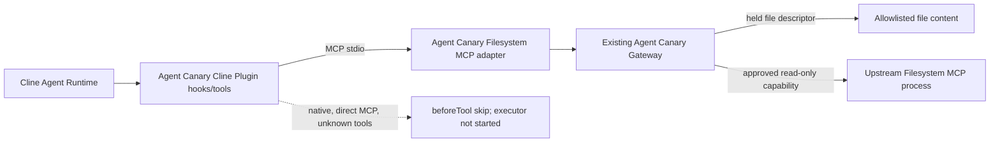

# Agent Canary R45 Integration Report

**Status: `INTEGRATED_AND_E2E_VERIFIED` for the pinned Cline SDK Plugin + Agent Runtime path described here.** The Cline CLI executable and IDE applications were not run and are outside this verified claim.

## Result

Agent Canary is integrated through Cline's public extension API. The pinned Cline plugin loader registered the plugin tools, the real `@cline/agents` Agent Runtime invoked them, and those calls crossed a real MCP stdio connection to the Agent Canary adapter. The adapter started the pinned upstream Filesystem MCP server as a separate real stdio process. Gateway decisions and actual results were correlated in JSONL evidence.

The integration does not provide OS-level confinement. Reads use the existing Gateway-held file capability; directory listing and file metadata use Gateway-authorized calls to the upstream read-only Filesystem MCP process. Writes are denied because the existing Gateway has no safe write primitive.

No E4, external model-provider request, or large model test matrix was run. The Cline Agent Runtime was driven by a deterministic in-process `AgentModel` only to issue the test tool calls; the MCP server, Gateway, plugin hooks, and actual tool execution were not mocked.

## Fixed upstream revisions

| Component | Fixed source / version | License and runtime notes |
| --- | --- | --- |
| Cline SDK Plugin / Core | `ea16751d6ae3ae1e443681994906bf29cbc45039`; `@cline/core@0.2.0` | Upstream repository Apache-2.0. Uses the public `AgentExtension` setup, tool, and hook contracts. |
| Cline Agent Runtime | Same Cline commit; `@cline/agents@0.2.0` | Upstream README marks this runtime experimental. |
| Filesystem MCP Server | `36380287ed3b15d115b55f546617d723072b1296`; `@modelcontextprotocol/server-filesystem@2.2.0` | Package requires Node.js `>=24` and declares `SEE LICENSE IN LICENSE`; consult the pinned upstream license file for its terms. |
| MCP SDK | `@modelcontextprotocol/sdk@1.32.1` | Used for real stdio clients and server request handling. |

The integration source authored here is MIT-licensed. Upstream source files were not copied or modified. Pinned source links and package evidence are in [`integrations/UPSTREAM-PINS.md`](integrations/UPSTREAM-PINS.md).

## Call path

The plugin does not register the upstream Filesystem MCP directly with Cline. It starts a private adapter connection per Cline session. The adapter starts upstream Filesystem MCP with `--read-only` and a single fixed workspace root. It exposes only five proxy tools; the Cline plugin registers four of them. Unknown tools and direct upstream tool names are denied.

## Implementation map

- Cline loadable entry is [`integrations/cline/src/plugin.js`](integrations/cline/src/plugin.js#L1); implementation and session bridge are in [`integrations/cline/src/plugin.mjs`](integrations/cline/src/plugin.mjs#L40). It starts one MCP client per plugin session, registers the four protected tools, and keeps tool identity and call-correlation state per plugin instance.
- `beforeTool` allows only the exact tool objects registered by this plugin. All other local Cline AgentTool calls return `skip: true` before the tool executor. `afterTool` records the Cline call ID and adapter call ID. See [`plugin.mjs`](integrations/cline/src/plugin.mjs#L92) and [`plugin.mjs`](integrations/cline/src/plugin.mjs#L132).
- The adapter implementation is [`integrations/filesystem-mcp/src/server.mjs`](integrations/filesystem-mcp/src/server.mjs#L122). It initializes the existing `createTrustedExecutionGateway`, validates allowlisted paths and exact argument shapes, verifies upstream tools are read-only, and handles MCP `tools/call` requests.
- Content reads use `bindFileReadCapability` and `readFileWithCapability`, so the Gateway reads from its held descriptor rather than forwarding the content read to upstream. Directory listing and file metadata use Gateway-registered read-only callbacks that call the actual upstream process. Writes are sent to the existing Gateway `write_file` decision and are never forwarded.
- The stdio entry point is [`integrations/filesystem-mcp/bin/agent-canary-filesystem-mcp.mjs`](integrations/filesystem-mcp/bin/agent-canary-filesystem-mcp.mjs#L1). The install and removal scripts are [`integrations/cline/install.ps1`](integrations/cline/install.ps1#L1) and [`integrations/cline/uninstall.ps1`](integrations/cline/uninstall.ps1#L1). Instructions and limitations are in [`integrations/cline/README.md`](integrations/cline/README.md) and [`integrations/filesystem-mcp/README.md`](integrations/filesystem-mcp/README.md).

## E2E evidence

Clean revalidation evidence against the fetched GitHub `main` baseline is in [`integrations/r45-evidence/run-20261106-r45-revalidated/`](integrations/r45-evidence/run-20261106-r45-revalidated/). It contains console output, fixture descriptions, raw adapter events, raw Gateway evidence, and a machine-readable summary. The source export's `run-20261106-r45-final` folder is preserved unchanged as supplied; it is not treated as the current-baseline run because its recorded write-denial reason differs from the Gateway in this clean checkout.

### Real Filesystem MCP stdio proxy

Test: [`integrations/filesystem-mcp/test/e2e.test.mjs`](integrations/filesystem-mcp/test/e2e.test.mjs#L27), run with Node `v24.22.1` and `npm run test:e2e`.

- Result: 1 test passed, 0 failed. MCP initialize, `tools/list`, and repeated `tools/call` requests were made over stdio. The upstream process reported ten tools; the proxy exposed only its five Agent Canary tools.
- Four operations succeeded: allowlisted public read, allowlisted business read, allowlisted directory listing, and allowlisted file metadata.
- Four operations were denied before execution: synthetic `.env` read (`credential_resource_denied`), write (`write_capability_disabled_pending_path_safe_primitive`), direct upstream `read_text_file` (`mcp_capability_denied`), and traversal (`mcp_capability_denied`). The synthetic write target remained unchanged.
- The raw adapter event log links MCP request ID, call ID, Gateway request IDs, decision, execution status, and result hash. Gateway evidence records `RUNNING`/`SUCCEEDED` for allowed operations and `NOT_STARTED` for denials.

### Cline SDK Agent Runtime path

Test: [`integrations/cline/test/runtime.test.mjs`](integrations/cline/test/runtime.test.mjs#L67), run with `npm run test:runtime`.

- Result: 1 test passed, 0 failed. It used Cline's `resolveAgentPluginPaths`, `loadAgentPluginFromPath`, `ContributionRegistry`, and the real `AgentRuntime` from the pinned packages.
- Seven protected adapter calls across two sessions produced five successes and two pre-execution Gateway denials. The successful calls were public/business reads, directory listing, metadata lookup, and a read in session B. The denied calls were the synthetic `.env` read and write.
- The runtime attempted a native `read_file`, a direct `read_text_file`, and an untrusted tool that reused the protected tool name. The Cline `beforeTool` hook skipped all three and their executor counters remained zero. The contribution registry contained no directly registered upstream MCP server.
- After the actual adapter child was closed, a subsequent protected read returned `Not connected` and no protected file content. A separate invalid adapter entry also left the protected tool closed. Neither case fell back to an unprotected read.
- Separate sessions had separate adapter processes, Gateways, and evidence files. Per-session call correlation is stored on the plugin instance, not shared module state.

Raw evidence files:

- [`filesystem-mcp-events.jsonl`](integrations/r45-evidence/run-20261106-r45-revalidated/filesystem-mcp-events.jsonl)
- [`filesystem-gateway-evidence.jsonl`](integrations/r45-evidence/run-20261106-r45-revalidated/filesystem-gateway-evidence.jsonl)
- [`cline-runtime-console.txt`](integrations/r45-evidence/run-20261106-r45-revalidated/cline-runtime-console.txt)
- Cline session-specific `mcp-events.jsonl` and `gateway-evidence.jsonl` under the same run directory
- [`security-summary.json`](integrations/r45-evidence/run-20261106-r45-revalidated/security-summary.json)

## Coverage and limits

| Capability | Result | Enforcement point |
| --- | --- | --- |
| Allowlisted text file read | Verified | Gateway-held file descriptor capability |
| Sensitive synthetic `.env` read | Denied before content read | Existing Gateway policy |
| Directory listing | Verified | Gateway read-only capability, then actual upstream MCP call |
| File metadata | Verified | Gateway read-only capability, then actual upstream MCP call |
| File write | Denied before forwarding | Existing Gateway; upstream also runs read-only |
| Direct upstream Filesystem MCP call | Denied | Adapter Gateway; Cline hook blocks direct host tool calls before the adapter |
| Path traversal / aliases | Denied | Adapter path validation and Gateway capability boundary |
| Unknown or spoofed tool names | Denied | Cline hook or adapter Gateway denial |
| Adapter startup / stdio loss | Fail-closed in tested cases | Protected callback errors; no direct fallback |
| Native Cline local AgentTools | Not allowed through tested SDK plugin path | `beforeTool` blocks every non-plugin tool |
| Shell/process tools, provider-executed tools, OS/IDE host paths | **OUT_OF_SCOPE** | Not tested as real host capabilities; no security guarantee claimed |
| Successful file writes | Not supported | Gateway safe write primitive is absent |
| OS-level confinement | Not provided | This is application-level routing, not an OS sandbox |

The CLI executable and Cline VS Code, JetBrains, and Desktop applications were not installed or run. A host that does not load and execute this plugin's `beforeTool` hook is outside the verified boundary. Do not expose direct filesystem MCP tools or enable native tools in such a host expecting this integration to protect them.

The Cline runtime package is experimental upstream. The install script's PowerShell syntax and the npm local dependency path were checked, but the installer was not run against the user's project tree. The scripts intentionally do not overwrite existing plugin paths.

## Git delivery

- The supplied directory is a source export without `.git` metadata. Its original report named branch `feature/r45-cline-filesystem-mcp-integration` and commits `501184c744af977c6ca8186a3307f99e53b8a015`, `08d1d7e8e5cf32cdc49400315f96c3451986ef5a`, `6207634a`, and `47b7d559`; those objects were not present in the export or the Git object database available during this import, so those provenance claims could not be independently verified.
- For publication, the R45 files were selectively applied to the fetched GitHub `main` baseline `16c48c5738c3ca4b02a2e4797b6a655c4b98da1a`. Existing files absent from the export were preserved, and the snapshot's unavailable Git history was not transplanted. The published repository's Git history is the authoritative record for this import.
- The source report described local deterministic integration tests only. No E4, external model-provider request, Issue #52 update, release, or formal product-source change is claimed here.
- The source report stated that unrelated dirty product and experiment files in its original checkout were left untouched and that tests used that checkout's local Gateway package build. Because this export contains no Git metadata or full original checkout, that workspace-state claim could not be independently checked during publication.

SHA-256 checksums for this report, the R45 source commit files, and the final clean-run evidence are recorded in [`integrations/r45-evidence/SHA256SUMS.txt`](integrations/r45-evidence/SHA256SUMS.txt). The checksum file does not hash itself.
