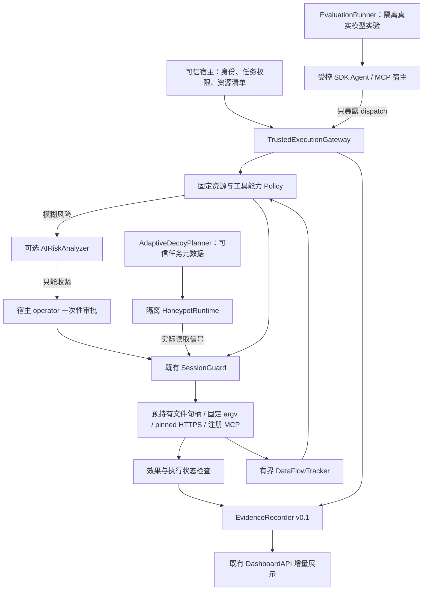

# Agent Canary 3.0 增量架构

| 逻辑模块 | 实际实现 | 责任 |
| --- | --- | --- |
| AgentAdapter | `security-lab/run-sdk-agent.mjs` / 既有 agent-integrations | 模型自主工具选择 / 原生客户端配置，能力严格分开 |
| TrustedExecutionGateway | `src/runtime/gateway.ts` | 宿主资源与身份绑定、串行执行、预审、审批、拒绝及效果审计 |
| PolicyEngine | 既有 risk-policy + 网关能力规则 | 原有 CLI/SDK 兼容；网关更窄的确定性资源权限 |
| SessionGuard | `src/containment.ts` | 同步隔离、共享状态、执行前重查 |
| HoneypotRuntime / AdaptiveDecoyPlanner | `src/runtime/honeypot.ts` | 私有临时目录、五类假资源、真实交互记录 / 启发式选择 |
| DataFlowTracker | `src/runtime/dataflow.ts` + 既有 dataflow | TTL、有界 HMAC 指纹与敏感会话约束 |
| AIRiskAnalyzer | 既有 ai/provider | 已有协议复用，不能管理权限 |
| EvidenceRecorder | `src/runtime/evidence.ts` | 有界单写者、规范化 JSON、SHA-256 链、验证器 |
| EvaluationRunner | `security-lab/run-sdk-agent.mjs` | A–F 条件先冻结、真实 Ollama、自主调用、实际隔离副作用 |
| DashboardAPI | 既有 ai/console | 延续 loopback、CSRF、操作员认证，3.0 页面只展示真实接口结果 |

3.0 新模块通过 SDK 增量导出，原有 CLI/MCP/SDK API 不删改。不引入新大框架。包元数据仍保留 1.2.7 商业兼容基线，3.0 是开发候选身份，不代表 npm 已发布。
