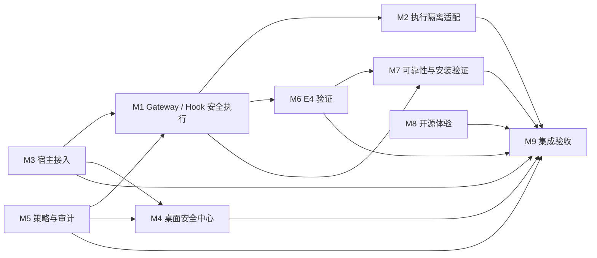

# M1–M9 模块依赖

本图基于现有架构文档、当前源码和实际分支/改动路径。对尚无提交、只有任务命名或当前线程不可读取的内容，标记为暂定；接口细节以 `API_CONTRACTS.md` 为准。

| 模块 | 主要输入 | 主要输出/边界 | 先稳定的接口 |
| --- | --- | --- | --- |
| M1 安全执行链 | 宿主身份、固定资源、`AgentGuard`、策略与 Evidence | 受限 dispatch、宿主审批、拒绝/效果证据；模型不能注册权限 | Gateway、Guard、Evidence |
| M2 执行隔离 | Gateway 已授权请求 | 隔离执行器及可检查结果；具体运行时/OS 边界待 PR 说明 | Gateway 执行与取消语义 |
| M3 宿主接入 | Agent 配置路径与安装项 | 检测、预览、安装、恢复；保留既有用户配置 | `AgentClient`、安装/恢复接口 |
| M4 桌面安全中心 | Console 状态、策略、事件 | 显示真实状态并调用受保护 API；不可绕过后端权限 | Console 路由、响应、CSRF/operator 审批 |
| M5 策略与审计 | 工具描述与保护模式 | 决策、风险、理由；OBSERVE 不可绕过 containment | `PolicyDecision`、Gateway 最终复查 |
| M6 E4 验证 | 固定 schema、证据文件、可信预期链尾（如有） | 机器可读验证结果和边界；格式校验不等于执行安全证明 | Evidence v0.1 |
| M7 可靠性 | 稳定 Gateway/Evidence API、打包目标 | 关闭、持久化、安装检查证据；验收范围在 PR 固化 | Gateway 生命周期、Evidence 持久化 |
| M8 开源体验 | 已稳定安装/API/测试/支持边界 | 文档只描述已验证能力 | 公共功能与发布状态 |
| M9 最终集成 | M1–M8 Draft PR、Issue、CI 和验收证据 | 集成候选分支上的兼容性/风险报告 | 所有公共契约与依赖测试 |

## 集成顺序

1. 冻结共同 AC3 基线并解决 M3/M6 基线差异；M0 不在含未提交修改的工作树自动 rebase。
2. 确认 M1 Gateway、Hook、Evidence 安全接口，再让 M5 策略和 M2 隔离适配它。
3. M3/M4 只消费受保护的宿主/Console API；M6 按冻结的 Evidence schema 验证，不改写证据含义。
4. M7 在接口稳定后验证文件、关闭和安装流程；M8 按验收事实更新开源文档。
5. M9 做跨模块验收。此顺序不改变模块所有权，也不授权合并 main 或发布 Release。

三个并行开发槽和 VMware/真实模型/安装互斥规则见 `TECHNICAL_ISSUES.md`。
