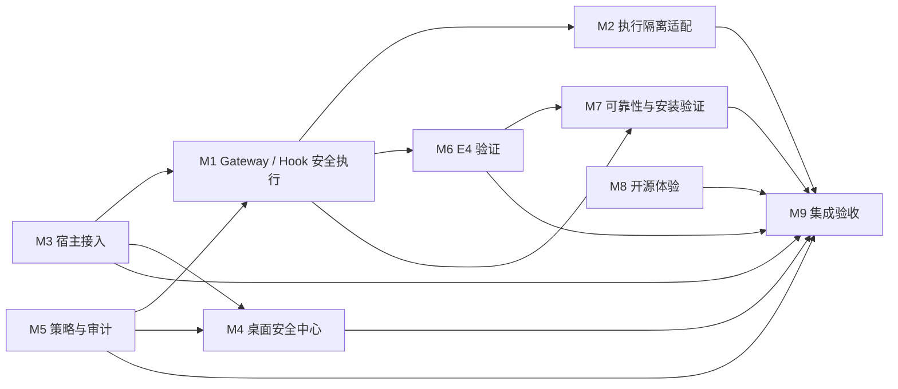

## Current schedule and dependencies (2026-10-15 20:32 UTC)

- Maximum active module lanes: two. M3 #55 and M7/M8 #53 missed the 20:32 status checkpoint without a visible owner reply or module-head change. Comments #55/6201691121 and #53/6201691288 request evidence or a concrete blocker by 20:52 UTC.
- M3 owns its native Hook copy and #55 correction. M9 #36 must keep its pinned refs unchanged until M3 denies unpinned native Read with `native_file_execution_not_pinned`, preserves M1 deny assertions, and passes the separate positive control; then rerun both composition platforms.
- M7 owns installer/payload evidence and M8 owns the Hook/logging copy. Their synthetic checks pass, but the real Setup.exe/payload and extracted-copy gate remains NOT_VERIFIED. Do not reserve/run VMware, real-model, or installer resources until the exclusive resource slot is recorded; none is active now.
- M1 owns #51 root-cause investigation; the original lock-holder/timing trigger remains UNKNOWN. Preserve retry behavior and assertions. M1/M2/M5 host acceptance #52 remains NOT_VERIFIED; M2 Native Codex Shell remains UNPROTECTED; M6 independent E4 remains NOT_VERIFIED.
- PR #24 remains untouched. AC3 module PRs target `feature/agent-canary-3.0` at `62496d4020bd90ba2eede49b2e80a2bbebb036b4`; legacy M6 PR #31 targets `main` and is not an AC3 integration input. Only the M0 coordinator worktree is visible in this clone.
- Usage page remains open and readable above the 5% stop threshold. Last M0 branch push was 20:16 UTC; next push no earlier than 20:37 UTC, after fresh quota and remote-ref checks.

## Archived schedule and dependencies (2026-10-15 20:25 UTC)

- Maximum active module lanes: two. The requested owner lanes remain M3 #55's fail-closed native Hook correction and M7/M8 #53's real package-artifact evidence; responses are due 20:32 UTC. No VMware, real-model, or installer resource is running or reserved.
- M1 owns Gateway held-descriptor semantics and strict `verifyRealPaths`; M2 adapts through its existing adapter and M5 owns policy decisions. First-party host adoption and protected-open evidence remain absent, so #52 stays open.
- M3 owns its native Hook copy and #55 unpinned-Read correction. M9 #36 product/wrapper CI passes, but current composition run `38727481764` fails on Ubuntu and Windows; M9 waits for corrected M3 evidence before repinning and rerunning.
- M1/M4 #51 diagnostic triage has not identified the original lock-holder/timing trigger. Preserve production lock/retry behavior and all assertions unless a defect is reproduced.
- M7 owns installer lifecycle evidence; M8 owns package/Hook-log reconciliation; M6 owns independent E4. Keep #41, #53, and external E4 NOT_VERIFIED until real acceptance evidence passes.
- PR #24 remains unchanged and OPEN/Draft. AC3 module PRs target `feature/agent-canary-3.0` at `62496d4020bd90ba2eede49b2e80a2bbebb036b4`; legacy M6 PR #31 targets `main` and is not an AC3 integration input. Only the M0 coordinator worktree is visible in this clone.
- Usage page remains open and readable above the stop threshold; do not store exact quota percentages in tracked files. Last M0 push was 20:16 UTC; next push no earlier than 20:37 UTC after fresh quota/ref checks.

## Archived schedule and dependencies (2026-10-15 20:12 UTC)

- Maximum active module tasks: two. Current owner lanes are M3's #55 fail-closed Hook correction and M7/M8's #53 real package-artifact evidence. No M3/M7/M8 owner response or corresponding PR-head change is visible at 20:12. M1 #52 and the M8/M9 source/CI audits are complete; their P0 gates remain open. VMware, real-model, and installation tests remain mutually exclusive and none is running or reserved.
- M1 owns Gateway held-descriptor semantics and the strict verifyRealPaths contract. M2 adapts through its existing adapter; M5 owns policy decisions. The production host-consumer edge is still absent/UNKNOWN, so synthetic composition cannot close #52.
- M3 owns its native Hook copy and the #55 unpinned-Read correction. PR #33 remains at be3880298e1c6766024ecbce5f6dbc23c4d2daa1 at the 20:12 read. M9 waits for the corrected M3 exact head before repinning and rerunning Ubuntu/Windows composition.
- M1/M4 #51 source-level diagnostic triage is complete, but the original lock-holder trigger remains UNKNOWN. Keep production retry/lock behavior and all assertions unchanged absent a reproduced defect.
- M7 owns installer lifecycle evidence; M8 owns packaged open-source experience and Hook-log reconciliation; M6 owns independent E4 evidence. Keep #41, #53, and external E4 NOT_VERIFIED until their real acceptance gates pass.
- PR #24 is unchanged and OPEN/Draft. All module PRs target feature/agent-canary-3.0 at 62496d4020bd90ba2eede49b2e80a2bbebb036b4.
- Usage page remains open/readable above the stop threshold; do not store exact quota percentages. Last branch push was 19:55 UTC; next push no earlier than 20:16 UTC.

# M1–M9 模块依赖

## Current schedule and dependencies (2026-10-15 16:44 UTC)

- Maximum active module lanes: two. Keep M1's existing #43/#51 lock-owner diagnostic follow-up and M3's existing #33/#55 contract correction as the active lanes. M9's composition rerun is dependency-gated until M3 publishes a corrected exact head; its #54 historical retry disposition is queued behind this contract blocker.
- Contract order: M1 owns the fail-closed unpinned native `Read` contract (`native_file_execution_not_pinned`); M3 must adapt its owned Hook copy/tests to that contract and add a separate supported-capability positive control; M9 then updates its exact M3 pin and reruns Ubuntu and Windows composition. Do not weaken M1's denial or silently make an incompatible shared-interface change.
- M1 #51 has already captured all four child outcomes, retry counts, sparse lock/state identity, and monotonic sample offsets. Only safe paired lock acquire/release owner/PID timing remains requested. The 500-attempt/2 ms behavior and 48 assertions remain fixed; the original trigger is UNKNOWN.
- M5 #47 (`373e2c2`) and M2 #37 (`9db59ed`) have passing exact-head CI, but M5's production protected-open/held-handle host path remains NOT_VERIFIED (#52). M2's actual Native Codex Shell remains UNPROTECTED (#45).
- M7 clean-VM installer lifecycle (#41), M8 package reachability/log reconciliation (#53), and M6 independent external E4 remain NOT_VERIFIED. Do not start VMware, real-model, or installer testing until an exclusive resource reservation is recorded on #29; no reservation is currently recorded.
- Current PR heads and checks are recorded in `TECHNICAL_STATUS.md` and `TECHNICAL_ISSUES.md`. PR #24 is still OPEN/Draft at `62496d4`; M0 #30 remote head is `3004dcf`, with product CI `38769306353` 9/9 and ownership check `38769777348` 1/1. Local docs-only commit `631b4cf` is scheduled for the 16:48 batch. No merge or Release is authorized.
- The Usage page remains open and readable; stop all work if it becomes unreadable or drops below 5%. Do not store account-specific quota percentages in tracked files. The last M0 push was 16:28 UTC; the next push batch is no earlier than 16:48 UTC.

## Current schedule and dependencies (2026-10-15 06:41 UTC)

- Maximum active module tasks: two. M9's cross-tree review is complete. The next owner action is M5's OBSERVE decision-contract reconciliation; M2's adapter validation follows that disposition. Keep these tasks on their existing branches/PRs.
- PR #24 remains OPEN/Draft and unchanged at head `62496d4`; its exact checks are 11/11. Current relevant PR heads: M0 #30 `494890c` has passing product checks but mixed ownership-check history; M2 #37 `04c7ec7` 9/9; M5 #47 `a6d610e` 9/9; M9 #36 `f87a70f` 11/11.
- M9 read-only review: its `security-router.decide()` projects explicit policy DENY under OBSERVE, while M5 #47 `security-router.decide()` returns `UNCHANGED` early and does not project `d.action === 'DENY'`. M5 `risk-policy` still denies the sensitive `.env` and outside aliases at dispatch when `verifyRealPaths` is enabled. M5 also lacks M9's blanket check of every symlink component for in-workspace, non-sensitive targets. Preserve this as an owner-visible semantic discrepancy; do not claim function-signature incompatibility.
- M2 adapter commit `76066cbb750ec714ce8691bc0f30c8171186f079` is now the fast-forward remote head of existing PR #37; exact-head CI is running. It remains absent from M9's checked-out CI tree. Its checker uses M2's older local `risk-policy` build, so it is not evidence for current M5 #47 semantics.
- Required integration order: (1) M5 owner resolves OBSERVE `decide()` behavior and symlink policy with focused tests under M5 ownership; (2) M2 places its adapter on existing PR #37 and validates against the agreed M5 boundary; (3) M9 tests actual checked-out M2/M5/M1 trees and separately asserts policy DENY versus adapter allowlist rejection. Issue #52 remains P0/OPEN until a production host consumes the adapter and protected-open evidence exists.
- M1 remains owner of the Gateway/Hook contracts; M5 owns policy decisions and delegates I/O to the host callback; M2 owns the execution-isolation adapter; M9 owns integration composition/tests. Public interface semantics change only through the interface owner and M0's canonical contract update.
- M1/#51 trigger remains UNKNOWN; preserve all retries and final assertions. M7 clean-VM installer lifecycle, external E4, native Shell enforcement, and M4 live security/E4 providers remain NOT_VERIFIED/UNKNOWN. No VMware, real-model, or installer resource is reserved.
- Keep the usage page open and readable. It was readable and above the 5% stop line at 06:32 UTC; stop all module work, browser actions, tests, and GitHub operations if unreadable or below 5%. Do not publish account-specific quota values.
- Last public writes: Issue #52 comment `6186150158` at 06:41:08 UTC and Issue #29 comment `6186150737` at 06:41:11 UTC. Next public-write batch no earlier than 07:01:11 UTC and only after rereading the usage page.
- Git uses Windows and WSL-managed worktrees. Preserve stale/prunable WSL metadata and original checkouts; do not prune or repair across runtimes. Do not create branches, merge main/PR #24, or publish a Release.

## Archived schedule and dependencies (2026-10-15 06:05 UTC)

- Maximum active module tasks: two. M1/#51 remains active; M2/#52 is active on its existing PR #37 adapter seam. M5's #52 call-site audit and M9's composition-test task are complete; M9 commit `f87a70f` is now pushed to PR #36 and exact-head CI is running.
- Current existing PR heads include M2 #37 `04c7ec7` (9/9), M3 #33 `1829e05` (9/9), M4 #34 `66e679b` (9/9), M5 #47 `a6d610e` (9/9), M6 #38 `c1fdf3c` (11/11), M7 #39 `87e0df0` (11/11), M8 #40 `454873c` (9/9), M1 #43 `f14aab7` (10/10), and M9 #36 `f87a70f` (new CI pending; parent `2d3f1da` passed 11/11). M0 #30 remains at `3b93f8b`; product CI passes 9/9, while the latest ownership check fails only because the PR body omits required evidence/API markers.
- The original M2/M8 WSL-managed directories remain untouched. Their existing PR heads now include the owner-copy canary changes. M2's wrapper matches M1's approved allowlist blob; M8's reachable wrapper/test match M1 canonical blobs. Neither change weakens Hook/interruption assertions.
- P1 evidence for M1/#51 remains: repeated `STATE_STORE_BUSY` through 500 retries reproduces `RETRY_LIMIT`, but lock-owner/timing traces are absent. Later exact-head runs pass; no source fix is justified and the original root cause remains UNKNOWN. Preserve all assertions.
- Interface dependency: M1 owns the Gateway's registered-file and fixed Hook contracts; M5 owns policy decisions and delegates actual I/O to the host callback; M7 packages the owner-approved wrapper. Adapters must send file execution through the M1 Gateway where applicable and must not persist raw tool arguments, decision reasons, paths, or caller-controlled log details.
- M5/#52 audit found no first-party production file-host consumer. M9's `f87a70f` test composes M5 OBSERVE routing with M1's registered-file Gateway: valid fixture reads use the Gateway, sensitive workspace and outside aliases deny before Gateway dispatch, approvals stay at zero, and fixtures remain unchanged. The test is synthetic; production-host enforcement remains NOT_VERIFIED.
- No VMware, real-model, or installer lifecycle resource is reserved or running. Record exclusive resource, owner, worktree, start, and release on #29 before starting such tests.
- Keep the usage page open and readable. M0 verified at 06:05 UTC that it was readable and above the 5% stop threshold; stop all module activity and GitHub operations if unreadable or below 5%. Do not publish account-specific quota values.
- The last public write was Issue #29 comment `6185450476` at 05:50:51 UTC; the next public-write batch must start no earlier than 06:10:51 UTC. Re-read the open usage page immediately before the batch.
- M2 task boundary: implement only an M2-owned adapter under `execution-isolation/gateway-adapter/` that routes M5 policy-approved registered-file work through M1 Gateway dispatch. No M1/M5 source edits, public API changes, arbitrary path execution, or claims of production protection without a real product callsite.
- Git uses Windows and WSL-managed worktrees. Do not repair or prune cross-runtime/stale WSL pointers from Windows; preserve current branch state.
- Git uses Windows and WSL-managed worktrees. Do not repair or prune cross-runtime/stale WSL pointers from Windows; preserve current branch state.

## Archived schedule and dependencies (2026-10-14 20:46 UTC)

- Maximum active module tasks: two. M1's #32 owner-disposition task is complete; assigned slots are M3/#32 first and M6/#27 package-field signoff. Queue M4/#32 and M6/#32 until slots release.
- M1's limited owner disposition is now visible: d3b64fc is accepted as behaviorally equivalent to 0de664c only for marker-wait/interruption timing. M3's branch copy is next; M4's and M6's copies are queued under #29. Each owner should port the minimal approved async fixture or record an evidence-backed reason; preserve all fail-closed checks.
- M6 must confirm or correct the three package fields e4:auto, e4:verify, and e4:test on the existing M6 PR. M0 does not edit those fields on M6's behalf.
- M9's package and test composition remains a static candidate only until owner signoff and combined exact-head CI; external E4 remains NOT_VERIFIED.
- M2 native Codex Shell remains UNPROTECTED; M7 clean-VM installer lifecycle is HOLD/NOT_VERIFIED; M4 backend security/E4 is UNKNOWN.
- The exclusive VMware/real-model/installer reservation cannot be read across other windows. Treat it as unavailable until an owner records reservation and release on #29.
- The usage page was readable locally at 20:46 UTC and above the stop threshold. The exact current reading is in the ignored local report; this current snapshot omits it, while older historical snapshots retain prior published readings. Stop if the 5-hour quota drops below 5% or becomes unreadable. Last push 20:26 UTC; next batch no earlier than 20:46 UTC.
- Worktrees are independent but use two Git runtimes: native Windows Git and WSL Git. Use the runtime that owns each worktree; do not run repair/prune across runtimes. M1/M2/M5/M8 currently track the AC3 base ref locally; use explicit remote branch refs for any push and verify destination first.

本图基于现有架构文档、当前源码和实际分支/改动路径。对尚无提交、只有任务命名或当前线程不可读取的内容，标记为暂定；接口细节以 `API_CONTRACTS.md` 为准。

## 当前排程覆盖（2026-10-14 19:18 UTC）

- M1–M8/M9 branches share merge-base `62496d4020bd90ba2eede49b2e80a2bbebb036b4`; the PR heads and exact-head CI are recorded in `MODULE_OWNERSHIP.md`. M9 #36 head `6abd4da` passes 9/9, and its Windows Community wrapper passes 2/2.
- The current two module work slots are M1/#32 and M6/#27. M1 owns the Hook fixture and needs to provide an owner-approved minimal update/adaptation or a reason the older #33/#34/#38 fixtures do not need one. M6 needs to explicitly confirm or correct `e4:auto`, `e4:verify`, and `e4:test` in the shared package manifest. Owner acknowledgement is not yet visible; route these tasks through the existing GitHub Issues.
- M3/M4/M6 current test-file blob is still `1ecb3ee` on PRs #33/#34/#38; M2 #37 carries `d3b64fc`, while M1 #43 and M9 #36 carry `6c2d8da`. Current green checks do not prove the historical marker timing race is eliminated. Preserve all fail-closed assertions and rerun the affected exact PR heads after any owner change.
- M7 #41 remains OPEN/HOLD: pinned Windows NSIS/template compile checks passed, but clean-VM install, launch, upgrade, uninstall, and real user-cancel rollback are NOT_VERIFIED. External E4 remains NOT_VERIFIED; native Codex Shell under #45 remains UNPROTECTED; M4 backend security/E4 state remains UNKNOWN.
- Usage page was active and readable at 19:10 UTC (5-hour 97%, weekly 64%, 113 credits). Last Git push batch: 19:04 UTC; next batch no earlier than 19:24 UTC. Below 5% or unreadable quota is a hard stop. VMware, real-model, and installer tests share one exclusive slot; this session has not started them, and occupancy in other windows is not directly visible, so reservation status is unconfirmed.

Cross-window task status is based only on visible worktree, PR, CI, Issue, and browser evidence. No M0 claim depends on reading another Codex conversation.

| 模块 | 主要输入 | 主要输出/边界 | 先稳定的接口 |
| --- | --- | --- | --- |
| M1 安全执行链 | 宿主身份、固定资源、`AgentGuard`、策略与 Evidence | 受限 dispatch、宿主审批、拒绝/效果证据；模型不能注册权限 | Gateway、Guard、Evidence |
| M2 执行隔离 | Gateway 已授权请求 | 隔离执行器及可检查结果；具体运行时/OS 边界待 PR 说明 | Gateway 执行与取消语义 |
| M3 宿主接入 | Agent 配置路径与安装项 | 检测、预览、安装、恢复；保留既有用户配置 | `AgentClient`、安装/恢复接口 |
| M4 桌面安全中心 | Console 状态、策略、事件 | 显示真实状态并调用受保护 API；不可绕过后端权限 | Console 路由、响应、CSRF/operator 审批 |
| M5 策略与审计 | 工具描述与保护模式 | 决策、风险、理由；OBSERVE 不可绕过 containment | `PolicyDecision`、Gateway 最终复查 |
| M6 E4 验证 | 固定 schema、证据文件、可信预期链尾（如有） | 机器可读验证结果和边界；格式校验不等于执行安全证明 | Evidence v0.1 |
| M7 可靠性 | 稳定 Gateway/Evidence API、打包目标 | 关闭、持久化、安装检查证据；验收范围在 PR 固化 | Gateway 生命周期、Evidence 持久化 |
| M8 开源体验 | 已稳定安装/API/测试/支持边界 | 文档只描述已验证能力 | 公共功能与发布状态 |
| M9 最终集成 | M1–M8 Draft PR、Issue、CI 和验收证据 | 集成候选分支上的兼容性/风险报告 | 所有公共契约与依赖测试 |

## 集成顺序

1. 冻结共同 AC3 基线并解决 M3/M6 基线差异；M0 不在含未提交修改的工作树自动 rebase。
2. 确认 M1 Gateway、Hook、Evidence 安全接口，再让 M5 策略和 M2 隔离适配它。
3. M3/M4 只消费受保护的宿主/Console API；M6 按冻结的 Evidence schema 验证，不改写证据含义。
4. M7 在接口稳定后验证文件、关闭和安装流程；M8 按验收事实更新开源文档。
5. M9 做跨模块验收。此顺序不改变模块所有权，也不授权合并 main 或发布 Release。

两个并行开发槽和 VMware/真实模型/安装互斥规则见 `TECHNICAL_ISSUES.md`。
