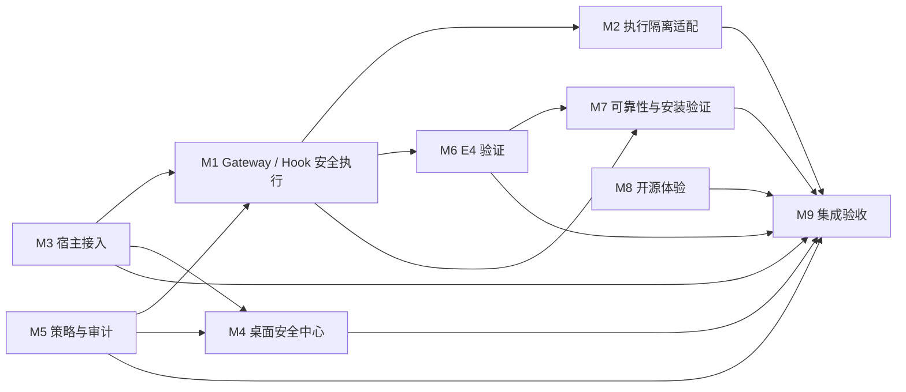

# M1–M9 模块依赖

## Current schedule and dependencies (2026-10-14 20:46 UTC)

- Maximum active module tasks: two. M1's #32 owner-disposition task is complete; assigned slots are M3/#32 first and M6/#27 package-field signoff. Queue M4/#32 and M6/#32 until slots release.
- M1's limited owner disposition is now visible: d3b64fc is accepted as behaviorally equivalent to 0de664c only for marker-wait/interruption timing. M3's branch copy is next; M4's and M6's copies are queued under #29. Each owner should port the minimal approved async fixture or record an evidence-backed reason; preserve all fail-closed checks.
- M6 must confirm or correct the three package fields e4:auto, e4:verify, and e4:test on the existing M6 PR. M0 does not edit those fields on M6's behalf.
- M9's package and test composition remains a static candidate only until owner signoff and combined exact-head CI; external E4 remains NOT_VERIFIED.
- M2 native Codex Shell remains UNPROTECTED; M7 clean-VM installer lifecycle is HOLD/NOT_VERIFIED; M4 backend security/E4 is UNKNOWN.
- The exclusive VMware/real-model/installer reservation cannot be read across other windows. Treat it as unavailable until an owner records reservation and release on #29.
- The usage page was readable locally at 20:46 UTC and above the stop threshold. The exact current reading is in the ignored local report; this current snapshot omits it, while older historical snapshots retain prior published readings. Stop if the 5-hour quota drops below 5% or becomes unreadable. Last push 20:26 UTC; next batch no earlier than 20:46 UTC.
- Worktrees are independent but use two Git runtimes: native Windows Git and WSL Git. Use the runtime that owns each worktree; do not run repair/prune across runtimes. M1/M2/M5/M8 currently track the AC3 base ref locally; use explicit remote branch refs for any push and verify destination first.

本图基于现有架构文档、当前源码和实际分支/改动路径。对尚无提交、只有任务命名或当前线程不可读取的内容，标记为暂定；接口细节以 `API_CONTRACTS.md` 为准。

## 当前排程覆盖（2026-10-14 19:18 UTC）

- M1–M8/M9 branches share merge-base `62496d4020bd90ba2eede49b2e80a2bbebb036b4`; the PR heads and exact-head CI are recorded in `MODULE_OWNERSHIP.md`. M9 #36 head `6abd4da` passes 9/9, and its Windows Community wrapper passes 2/2.
- The current two module work slots are M1/#32 and M6/#27. M1 owns the Hook fixture and needs to provide an owner-approved minimal update/adaptation or a reason the older #33/#34/#38 fixtures do not need one. M6 needs to explicitly confirm or correct `e4:auto`, `e4:verify`, and `e4:test` in the shared package manifest. Owner acknowledgement is not yet visible; route these tasks through the existing GitHub Issues.
- M3/M4/M6 current test-file blob is still `1ecb3ee` on PRs #33/#34/#38; M2 #37 carries `d3b64fc`, while M1 #43 and M9 #36 carry `6c2d8da`. Current green checks do not prove the historical marker timing race is eliminated. Preserve all fail-closed assertions and rerun the affected exact PR heads after any owner change.
- M7 #41 remains OPEN/HOLD: pinned Windows NSIS/template compile checks passed, but clean-VM install, launch, upgrade, uninstall, and real user-cancel rollback are NOT_VERIFIED. External E4 remains NOT_VERIFIED; native Codex Shell under #45 remains UNPROTECTED; M4 backend security/E4 state remains UNKNOWN.
- Usage page was active and readable at 19:10 UTC (5-hour 97%, weekly 64%, 113 credits). Last Git push batch: 19:04 UTC; next batch no earlier than 19:24 UTC. Below 5% or unreadable quota is a hard stop. VMware, real-model, and installer tests share one exclusive slot; this session has not started them, and occupancy in other windows is not directly visible, so reservation status is unconfirmed.

Cross-window task status is based only on visible worktree, PR, CI, Issue, and browser evidence. No M0 claim depends on reading another Codex conversation.

| 模块 | 主要输入 | 主要输出/边界 | 先稳定的接口 |
| --- | --- | --- | --- |
| M1 安全执行链 | 宿主身份、固定资源、`AgentGuard`、策略与 Evidence | 受限 dispatch、宿主审批、拒绝/效果证据；模型不能注册权限 | Gateway、Guard、Evidence |
| M2 执行隔离 | Gateway 已授权请求 | 隔离执行器及可检查结果；具体运行时/OS 边界待 PR 说明 | Gateway 执行与取消语义 |
| M3 宿主接入 | Agent 配置路径与安装项 | 检测、预览、安装、恢复；保留既有用户配置 | `AgentClient`、安装/恢复接口 |
| M4 桌面安全中心 | Console 状态、策略、事件 | 显示真实状态并调用受保护 API；不可绕过后端权限 | Console 路由、响应、CSRF/operator 审批 |
| M5 策略与审计 | 工具描述与保护模式 | 决策、风险、理由；OBSERVE 不可绕过 containment | `PolicyDecision`、Gateway 最终复查 |
| M6 E4 验证 | 固定 schema、证据文件、可信预期链尾（如有） | 机器可读验证结果和边界；格式校验不等于执行安全证明 | Evidence v0.1 |
| M7 可靠性 | 稳定 Gateway/Evidence API、打包目标 | 关闭、持久化、安装检查证据；验收范围在 PR 固化 | Gateway 生命周期、Evidence 持久化 |
| M8 开源体验 | 已稳定安装/API/测试/支持边界 | 文档只描述已验证能力 | 公共功能与发布状态 |
| M9 最终集成 | M1–M8 Draft PR、Issue、CI 和验收证据 | 集成候选分支上的兼容性/风险报告 | 所有公共契约与依赖测试 |

## 集成顺序

1. 冻结共同 AC3 基线并解决 M3/M6 基线差异；M0 不在含未提交修改的工作树自动 rebase。
2. 确认 M1 Gateway、Hook、Evidence 安全接口，再让 M5 策略和 M2 隔离适配它。
3. M3/M4 只消费受保护的宿主/Console API；M6 按冻结的 Evidence schema 验证，不改写证据含义。
4. M7 在接口稳定后验证文件、关闭和安装流程；M8 按验收事实更新开源文档。
5. M9 做跨模块验收。此顺序不改变模块所有权，也不授权合并 main 或发布 Release。

两个并行开发槽和 VMware/真实模型/安装互斥规则见 `TECHNICAL_ISSUES.md`。
