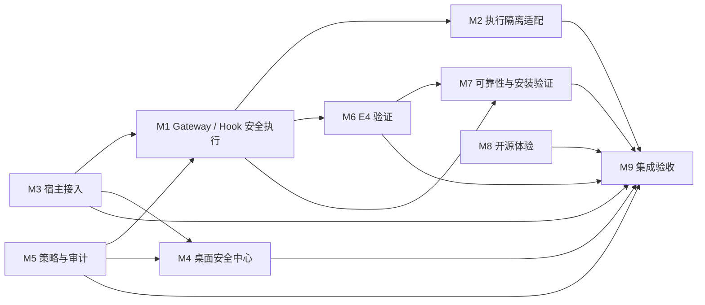

## Current configured-target dependency status — 2026-10-25 06:31 UTC

The current feature source contains M3's normal-CLI configured-target route; older entries below saying the route is absent are historical snapshots. Dependency order is M1 held-file identity/capability → M2 public fixed-resource host adapter → M5 strict OBSERVE router → M3 CLI configuration, binding, and status-only route → M4 read-only Security Center consumer → M9 exact-ref composition. Exact M9 composition run `40169026928` passed on Ubuntu and Windows for M0 PR #119 head `ac48cdb`, checking the current M1–M8 refs. M3's protected-read endpoint remains a fixed temporary-marker probe; the M4 UI intentionally does not call it. M3/M4 shipped-package/native-host acceptance remains outstanding; keep #52 OPEN/P0/NOT_VERIFIED and do not infer OS-atomic TOCTOU protection.

## M0 ownership/dependency delta — 2026-10-15 21:16 UTC

- Issue #56 tracks a PR-scope ownership overlap: M0 PR #30 currently carries an M1-owned `test/agent-hook.test.ts` diff while PR #43 also changes the canonical path. The PR #30 timeline has no visible M1 review/disposition; approval is UNKNOWN. Keep #30 Draft until the file-level diff and scope are reconciled, preserving the regression test.
- The M3 #55 and M7/M8 #53 owner deadline at 21:12 passed without issue replies or PR-head changes. Follow-up messages were queued to existing M3 and M7 sessions at 21:16; they remain the two active lanes. Queue acceptance does not prove implementation started. Next evidence/blocker checkpoint is 21:32 UTC.
- Usage page remains open/readable above the stop threshold. Last M0 push was 20:58 UTC; next is no earlier than 21:19 UTC after fresh quota, PR #24, and remote-head checks.

## M0 dependency delta — 2026-10-15 21:06 UTC

- The two assigned lanes remain M3 #55 and M7 #53 (M8 supplies its copy evidence through #53). No corresponding PR-head movement or owner reply was visible by 21:03; owner evidence/blocker is due 21:12 UTC.
- M9 run `38727481764` confirms the same unpinned-Read mismatch on Windows and Ubuntu, but its M1 pin is `b1d7423e70f2d47f43a5ec42e63a650ff93f6dcc`, not current M1 PR #43 head `9ef3dc265f9f386508bbeec7ff6d9a264ab1a0a4`. M3 owns the denial correction; M9 retains its exact refs until M3 advances, then must rerun both platforms with current refs. See Issue #55 comment `6202315177`.
- Under this coordinator clone, `main`, `agents`, and `integration` are empty; only the coordinator worktree is registered. Other module worktree isolation remains UNKNOWN.
- Usage page remains open/readable above the pause threshold. Last M0 push was 20:58 UTC; next is no earlier than 21:19 UTC after fresh quota and ref checks. VMware, real-model, and installer tests remain mutually exclusive; no slot is active/reserved.

## Current schedule and dependencies (2026-10-15 20:52 UTC)

- Two existing work lanes are assigned: M3 owns #55 and M7 owns the package-artifact portion of #53, coordinating M8's Hook-copy evidence through the issue. Their existing sessions accepted tasks at 20:44, but no PR-head movement or issue response was visible at the 20:52 checkpoint. Evidence/blocker is due 21:12.
- M1 is the owner of the fail-closed Hook/Gateway contract; M3 must deny unpinned native Read with native_file_execution_not_pinned while retaining M1 denials and a passing supported-capability positive control. M9 must keep its current refs until M3 publishes, then rerun Ubuntu and Windows composition.
- M5's current PR #47 includes alias-denial fixes and passes its exact-head CI. M2's fixed-resource adapter remains synthetic and is not wired to a first-party host. M1/M2/M5 host protected-open, held-handle consumption, current-head host composition, and TOCTOU remain NOT_VERIFIED under #52.
- M7 owns installer/payload build and lifecycle; M8 owns the Hook/logging copy; M6 owns E4 validation. The extracted package/harness gate (#53), clean-VM lifecycle (#41), and independent external E4 remain separate evidence gates.
- M2's actual Native Codex Shell remains UNPROTECTED (#45). M1 owns the unresolved shared-store retry trigger (#51); preserve retries and assertions. M9 owns integration test diagnostics for #54; AI provider/transport source remains unassigned absent a reproduced recurrence.
- P0/P1/P2 GitHub labels are applied to the eight open coordination/security Issues. VMware, real-model, and installer tests share one exclusive slot; none is currently running or reserved.
- All AC3 PRs continue to target feature/agent-canary-3.0 at 62496d4020bd90ba2eede49b2e80a2bbebb036b4. PR #24 remains unchanged. This clone can verify only the coordinator worktree; other local worktree isolation remains UNKNOWN.
- Usage page remains open/readable above the 5% pause threshold. Last M0 push was 20:37 UTC; the next push is no earlier than 20:58 UTC after fresh quota and remote-ref checks.

## Archived schedule and dependencies (2026-10-15 20:32 UTC)

- Maximum active module lanes: two. M3 #55 and M7/M8 #53 missed the 20:32 status checkpoint without a visible owner reply or module-head change. Comments #55/6201691121 and #53/6201691288 request evidence or a concrete blocker by 20:52 UTC.
- M3 owns its native Hook copy and #55 correction. M9 #36 must keep its pinned refs unchanged until M3 denies unpinned native Read with `native_file_execution_not_pinned`, preserves M1 deny assertions, and passes the separate positive control; then rerun both composition platforms.
- M7 owns installer/payload evidence and M8 owns the Hook/logging copy. Their synthetic checks pass, but the real Setup.exe/payload and extracted-copy gate remains NOT_VERIFIED. Do not reserve/run VMware, real-model, or installer resources until the exclusive resource slot is recorded; none is active now.
- M1 owns #51 root-cause investigation; the original lock-holder/timing trigger remains UNKNOWN. Preserve retry behavior and assertions. M1/M2/M5 host acceptance #52 remains NOT_VERIFIED; M2 Native Codex Shell remains UNPROTECTED; M6 independent E4 remains NOT_VERIFIED.
- PR #24 remains untouched. AC3 module PRs target `feature/agent-canary-3.0` at `62496d4020bd90ba2eede49b2e80a2bbebb036b4`; legacy M6 PR #31 targets `main` and is not an AC3 integration input. Only the M0 coordinator worktree is visible in this clone.
- Usage page remains open and readable above the 5% stop threshold. Last M0 branch push was 20:16 UTC; next push no earlier than 20:37 UTC, after fresh quota and remote-ref checks.

## Archived schedule and dependencies (2026-10-15 20:25 UTC)

- Maximum active module lanes: two. The requested owner lanes remain M3 #55's fail-closed native Hook correction and M7/M8 #53's real package-artifact evidence; responses are due 20:32 UTC. No VMware, real-model, or installer resource is running or reserved.
- M1 owns Gateway held-descriptor semantics and strict `verifyRealPaths`; M2 adapts through its existing adapter and M5 owns policy decisions. First-party host adoption and protected-open evidence remain absent, so #52 stays open.
- M3 owns its native Hook copy and #55 unpinned-Read correction. M9 #36 product/wrapper CI passes, but current composition run `38727481764` fails on Ubuntu and Windows; M9 waits for corrected M3 evidence before repinning and rerunning.
- M1/M4 #51 diagnostic triage has not identified the original lock-holder/timing trigger. Preserve production lock/retry behavior and all assertions unless a defect is reproduced.
- M7 owns installer lifecycle evidence; M8 owns package/Hook-log reconciliation; M6 owns independent E4. Keep #41, #53, and external E4 NOT_VERIFIED until real acceptance evidence passes.
- PR #24 remains unchanged and OPEN/Draft. AC3 module PRs target `feature/agent-canary-3.0` at `62496d4020bd90ba2eede49b2e80a2bbebb036b4`; legacy M6 PR #31 targets `main` and is not an AC3 integration input. Only the M0 coordinator worktree is visible in this clone.
- Usage page remains open and readable above the stop threshold; do not store exact quota percentages in tracked files. Last M0 push was 20:16 UTC; next push no earlier than 20:37 UTC after fresh quota/ref checks.

## Archived schedule and dependencies (2026-10-15 20:12 UTC)

- Maximum active module tasks: two. Current owner lanes are M3's #55 fail-closed Hook correction and M7/M8's #53 real package-artifact evidence. No M3/M7/M8 owner response or corresponding PR-head change is visible at 20:12. M1 #52 and the M8/M9 source/CI audits are complete; their P0 gates remain open. VMware, real-model, and installation tests remain mutually exclusive and none is running or reserved.
- M1 owns Gateway held-descriptor semantics and the strict verifyRealPaths contract. M2 adapts through its existing adapter; M5 owns policy decisions. The production host-consumer edge is still absent/UNKNOWN, so synthetic composition cannot close #52.
- M3 owns its native Hook copy and the #55 unpinned-Read correction. PR #33 remains at be3880298e1c6766024ecbce5f6dbc23c4d2daa1 at the 20:12 read. M9 waits for the corrected M3 exact head before repinning and rerunning Ubuntu/Windows composition.
- M1/M4 #51 source-level diagnostic triage is complete, but the original lock-holder trigger remains UNKNOWN. Keep production retry/lock behavior and all assertions unchanged absent a reproduced defect.
- M7 owns installer lifecycle evidence; M8 owns packaged open-source experience and Hook-log reconciliation; M6 owns independent E4 evidence. Keep #41, #53, and external E4 NOT_VERIFIED until their real acceptance gates pass.
- PR #24 is unchanged and OPEN/Draft. All module PRs target feature/agent-canary-3.0 at 62496d4020bd90ba2eede49b2e80a2bbebb036b4.
- Usage page remains open/readable above the stop threshold; do not store exact quota percentages. Last branch push was 19:55 UTC; next push no earlier than 20:16 UTC.

# M1–M9 模块依赖

## Current schedule and dependencies (2026-10-15 16:44 UTC)

- Maximum active module lanes: two. Keep M1's existing #43/#51 lock-owner diagnostic follow-up and M3's existing #33/#55 contract correction as the active lanes. M9's composition rerun is dependency-gated until M3 publishes a corrected exact head; its #54 historical retry disposition is queued behind this contract blocker.
- Contract order: M1 owns the fail-closed unpinned native `Read` contract (`native_file_execution_not_pinned`); M3 must adapt its owned Hook copy/tests to that contract and add a separate supported-capability positive control; M9 then updates its exact M3 pin and reruns Ubuntu and Windows composition. Do not weaken M1's denial or silently make an incompatible shared-interface change.
- M1 #51 has already captured all four child outcomes, retry counts, sparse lock/state identity, and monotonic sample offsets. Only safe paired lock acquire/release owner/PID timing remains requested. The 500-attempt/2 ms behavior and 48 assertions remain fixed; the original trigger is UNKNOWN.
- M5 #47 (`373e2c2`) and M2 #37 (`9db59ed`) have passing exact-head CI, but M5's production protected-open/held-handle host path remains NOT_VERIFIED (#52). M2's actual Native Codex Shell remains UNPROTECTED (#45).
- M7 clean-VM installer lifecycle (#41), M8 package reachability/log reconciliation (#53), and M6 independent external E4 remain NOT_VERIFIED. Do not start VMware, real-model, or installer testing until an exclusive resource reservation is recorded on #29; no reservation is currently recorded.
- Current PR heads and checks are recorded in `TECHNICAL_STATUS.md` and `TECHNICAL_ISSUES.md`. PR #24 is still OPEN/Draft at `62496d4`; M0 #30 remote head is `3004dcf`, with product CI `38769306353` 9/9 and ownership check `38769777348` 1/1. Local docs-only commit `631b4cf` is scheduled for the 16:48 batch. No merge or Release is authorized.
- The Usage page remains open and readable; stop all work if it becomes unreadable or drops below 5%. Do not store account-specific quota percentages in tracked files. The last M0 push was 16:28 UTC; the next push batch is no earlier than 16:48 UTC.

## Current schedule and dependencies (2026-10-15 06:41 UTC)

- Maximum active module tasks: two. M9's cross-tree review is complete. The next owner action is M5's OBSERVE decision-contract reconciliation; M2's adapter validation follows that disposition. Keep these tasks on their existing branches/PRs.
- PR #24 remains OPEN/Draft and unchanged at head `62496d4`; its exact checks are 11/11. Current relevant PR heads: M0 #30 `494890c` has passing product checks but mixed ownership-check history; M2 #37 `04c7ec7` 9/9; M5 #47 `a6d610e` 9/9; M9 #36 `f87a70f` 11/11.
- M9 read-only review: its `security-router.decide()` projects explicit policy DENY under OBSERVE, while M5 #47 `security-router.decide()` returns `UNCHANGED` early and does not project `d.action === 'DENY'`. M5 `risk-policy` still denies the sensitive `.env` and outside aliases at dispatch when `verifyRealPaths` is enabled. M5 also lacks M9's blanket check of every symlink component for in-workspace, non-sensitive targets. Preserve this as an owner-visible semantic discrepancy; do not claim function-signature incompatibility.
- M2 adapter commit `76066cbb750ec714ce8691bc0f30c8171186f079` is now the fast-forward remote head of existing PR #37; exact-head CI is running. It remains absent from M9's checked-out CI tree. Its checker uses M2's older local `risk-policy` build, so it is not evidence for current M5 #47 semantics.
- Required integration order: (1) M5 owner resolves OBSERVE `decide()` behavior and symlink policy with focused tests under M5 ownership; (2) M2 places its adapter on existing PR #37 and validates against the agreed M5 boundary; (3) M9 tests actual checked-out M2/M5/M1 trees and separately asserts policy DENY versus adapter allowlist rejection. Issue #52 remains P0/OPEN until a production host consumes the adapter and protected-open evidence exists.
- M1 remains owner of the Gateway/Hook contracts; M5 owns policy decisions and delegates I/O to the host callback; M2 owns the execution-isolation adapter; M9 owns integration composition/tests. Public interface semantics change only through the interface owner and M0's canonical contract update.
- M1/#51 trigger remains UNKNOWN; preserve all retries and final assertions. M7 clean-VM installer lifecycle, external E4, native Shell enforcement, and M4 live security/E4 providers remain NOT_VERIFIED/UNKNOWN. No VMware, real-model, or installer resource is reserved.
- Keep the usage page open and readable. It was readable and above the 5% stop line at 06:32 UTC; stop all module work, browser actions, tests, and GitHub operations if unreadable or below 5%. Do not publish account-specific quota values.
- Last public writes: Issue #52 comment `6186150158` at 06:41:08 UTC and Issue #29 comment `6186150737` at 06:41:11 UTC. Next public-write batch no earlier than 07:01:11 UTC and only after rereading the usage page.
- Git uses Windows and WSL-managed worktrees. Preserve stale/prunable WSL metadata and original checkouts; do not prune or repair across runtimes. Do not create branches, merge main/PR #24, or publish a Release.

## Archived schedule and dependencies (2026-10-15 06:05 UTC)

- Maximum active module tasks: two. M1/#51 remains active; M2/#52 is active on its existing PR #37 adapter seam. M5's #52 call-site audit and M9's composition-test task are complete; M9 commit `f87a70f` is now pushed to PR #36 and exact-head CI is running.
- Current existing PR heads include M2 #37 `04c7ec7` (9/9), M3 #33 `1829e05` (9/9), M4 #34 `66e679b` (9/9), M5 #47 `a6d610e` (9/9), M6 #38 `c1fdf3c` (11/11), M7 #39 `87e0df0` (11/11), M8 #40 `454873c` (9/9), M1 #43 `f14aab7` (10/10), and M9 #36 `f87a70f` (new CI pending; parent `2d3f1da` passed 11/11). M0 #30 remains at `3b93f8b`; product CI passes 9/9, while the latest ownership check fails only because the PR body omits required evidence/API markers.
- The original M2/M8 WSL-managed directories remain untouched. Their existing PR heads now include the owner-copy canary changes. M2's wrapper matches M1's approved allowlist blob; M8's reachable wrapper/test match M1 canonical blobs. Neither change weakens Hook/interruption assertions.
- P1 evidence for M1/#51 remains: repeated `STATE_STORE_BUSY` through 500 retries reproduces `RETRY_LIMIT`, but lock-owner/timing traces are absent. Later exact-head runs pass; no source fix is justified and the original root cause remains UNKNOWN. Preserve all assertions.
- Interface dependency: M1 owns the Gateway's registered-file and fixed Hook contracts; M5 owns policy decisions and delegates actual I/O to the host callback; M7 packages the owner-approved wrapper. Adapters must send file execution through the M1 Gateway where applicable and must not persist raw tool arguments, decision reasons, paths, or caller-controlled log details.
- M5/#52 audit found no first-party production file-host consumer. M9's `f87a70f` test composes M5 OBSERVE routing with M1's registered-file Gateway: valid fixture reads use the Gateway, sensitive workspace and outside aliases deny before Gateway dispatch, approvals stay at zero, and fixtures remain unchanged. The test is synthetic; production-host enforcement remains NOT_VERIFIED.
- No VMware, real-model, or installer lifecycle resource is reserved or running. Record exclusive resource, owner, worktree, start, and release on #29 before starting such tests.
- Keep the usage page open and readable. M0 verified at 06:05 UTC that it was readable and above the 5% stop threshold; stop all module activity and GitHub operations if unreadable or below 5%. Do not publish account-specific quota values.
- The last public write was Issue #29 comment `6185450476` at 05:50:51 UTC; the next public-write batch must start no earlier than 06:10:51 UTC. Re-read the open usage page immediately before the batch.
- M2 task boundary: implement only an M2-owned adapter under `execution-isolation/gateway-adapter/` that routes M5 policy-approved registered-file work through M1 Gateway dispatch. No M1/M5 source edits, public API changes, arbitrary path execution, or claims of production protection without a real product callsite.
- Git uses Windows and WSL-managed worktrees. Do not repair or prune cross-runtime/stale WSL pointers from Windows; preserve current branch state.
- Git uses Windows and WSL-managed worktrees. Do not repair or prune cross-runtime/stale WSL pointers from Windows; preserve current branch state.

## Archived schedule and dependencies (2026-10-14 20:46 UTC)

- Maximum active module tasks: two. M1's #32 owner-disposition task is complete; assigned slots are M3/#32 first and M6/#27 package-field signoff. Queue M4/#32 and M6/#32 until slots release.
- M1's limited owner disposition is now visible: d3b64fc is accepted as behaviorally equivalent to 0de664c only for marker-wait/interruption timing. M3's branch copy is next; M4's and M6's copies are queued under #29. Each owner should port the minimal approved async fixture or record an evidence-backed reason; preserve all fail-closed checks.
- M6 must confirm or correct the three package fields e4:auto, e4:verify, and e4:test on the existing M6 PR. M0 does not edit those fields on M6's behalf.
- M9's package and test composition remains a static candidate only until owner signoff and combined exact-head CI; external E4 remains NOT_VERIFIED.
- M2 native Codex Shell remains UNPROTECTED; M7 clean-VM installer lifecycle is HOLD/NOT_VERIFIED; M4 backend security/E4 is UNKNOWN.
- The exclusive VMware/real-model/installer reservation cannot be read across other windows. Treat it as unavailable until an owner records reservation and release on #29.
- The usage page was readable locally at 20:46 UTC and above the stop threshold. The exact current reading is in the ignored local report; this current snapshot omits it, while older historical snapshots retain prior published readings. Stop if the 5-hour quota drops below 5% or becomes unreadable. Last push 20:26 UTC; next batch no earlier than 20:46 UTC.
- Worktrees are independent but use two Git runtimes: native Windows Git and WSL Git. Use the runtime that owns each worktree; do not run repair/prune across runtimes. M1/M2/M5/M8 currently track the AC3 base ref locally; use explicit remote branch refs for any push and verify destination first.

本图基于现有架构文档、当前源码和实际分支/改动路径。对尚无提交、只有任务命名或当前线程不可读取的内容，标记为暂定；接口细节以 `API_CONTRACTS.md` 为准。

## 当前排程覆盖（2026-10-14 19:18 UTC）

- M1–M8/M9 branches share merge-base `62496d4020bd90ba2eede49b2e80a2bbebb036b4`; the PR heads and exact-head CI are recorded in `MODULE_OWNERSHIP.md`. M9 #36 head `6abd4da` passes 9/9, and its Windows Community wrapper passes 2/2.
- The current two module work slots are M1/#32 and M6/#27. M1 owns the Hook fixture and needs to provide an owner-approved minimal update/adaptation or a reason the older #33/#34/#38 fixtures do not need one. M6 needs to explicitly confirm or correct `e4:auto`, `e4:verify`, and `e4:test` in the shared package manifest. Owner acknowledgement is not yet visible; route these tasks through the existing GitHub Issues.
- M3/M4/M6 current test-file blob is still `1ecb3ee` on PRs #33/#34/#38; M2 #37 carries `d3b64fc`, while M1 #43 and M9 #36 carry `6c2d8da`. Current green checks do not prove the historical marker timing race is eliminated. Preserve all fail-closed assertions and rerun the affected exact PR heads after any owner change.
- M7 #41 remains OPEN/HOLD: pinned Windows NSIS/template compile checks passed, but clean-VM install, launch, upgrade, uninstall, and real user-cancel rollback are NOT_VERIFIED. External E4 remains NOT_VERIFIED; native Codex Shell under #45 remains UNPROTECTED; M4 backend security/E4 state remains UNKNOWN.
- Usage page was active and readable at 19:10 UTC (5-hour 97%, weekly 64%, 113 credits). Last Git push batch: 19:04 UTC; next batch no earlier than 19:24 UTC. Below 5% or unreadable quota is a hard stop. VMware, real-model, and installer tests share one exclusive slot; this session has not started them, and occupancy in other windows is not directly visible, so reservation status is unconfirmed.

Cross-window task status is based only on visible worktree, PR, CI, Issue, and browser evidence. No M0 claim depends on reading another Codex conversation.

| 模块 | 主要输入 | 主要输出/边界 | 先稳定的接口 |
| --- | --- | --- | --- |
| M1 安全执行链 | 宿主身份、固定资源、`AgentGuard`、策略与 Evidence | 受限 dispatch、宿主审批、拒绝/效果证据；模型不能注册权限 | Gateway、Guard、Evidence |
| M2 执行隔离 | Gateway 已授权请求 | 隔离执行器及可检查结果；具体运行时/OS 边界待 PR 说明 | Gateway 执行与取消语义 |
| M3 宿主接入 | Agent 配置路径与安装项 | 检测、预览、安装、恢复；保留既有用户配置 | `AgentClient`、安装/恢复接口 |
| M4 桌面安全中心 | Console 状态、策略、事件 | 显示真实状态并调用受保护 API；不可绕过后端权限 | Console 路由、响应、CSRF/operator 审批 |
| M5 策略与审计 | 工具描述与保护模式 | 决策、风险、理由；OBSERVE 不可绕过 containment | `PolicyDecision`、Gateway 最终复查 |
| M6 E4 验证 | 固定 schema、证据文件、可信预期链尾（如有） | 机器可读验证结果和边界；格式校验不等于执行安全证明 | Evidence v0.1 |
| M7 可靠性 | 稳定 Gateway/Evidence API、打包目标 | 关闭、持久化、安装检查证据；验收范围在 PR 固化 | Gateway 生命周期、Evidence 持久化 |
| M8 开源体验 | 已稳定安装/API/测试/支持边界 | 文档只描述已验证能力 | 公共功能与发布状态 |
| M9 最终集成 | M1–M8 Draft PR、Issue、CI 和验收证据 | 集成候选分支上的兼容性/风险报告 | 所有公共契约与依赖测试 |

## 集成顺序

1. 冻结共同 AC3 基线并解决 M3/M6 基线差异；M0 不在含未提交修改的工作树自动 rebase。
2. 确认 M1 Gateway、Hook、Evidence 安全接口，再让 M5 策略和 M2 隔离适配它。
3. M3/M4 只消费受保护的宿主/Console API；M6 按冻结的 Evidence schema 验证，不改写证据含义。
4. M7 在接口稳定后验证文件、关闭和安装流程；M8 按验收事实更新开源文档。
5. M9 做跨模块验收。此顺序不改变模块所有权，也不授权合并 main 或发布 Release。

两个并行开发槽和 VMware/真实模型/安装互斥规则见 `TECHNICAL_ISSUES.md`。

## Current M6–M8 to M9 packaging dependency — Issue #59

- M7 owns the installer/build pipeline and its packaging lifecycle checks; M6 owns the E4 verifier/evidence contract; M8 owns its shipped Hook copy and product-facing claims.
- M9 consumes the selected exact M6/M7/M8 SHAs and runs the combined Windows packaging/auto-E4 checks. Divergent owner-controlled files must be reconciled before pinning; use an adapter at the boundary and obtain the primary owner's review for shared semantics.
- Issue #59 is OPEN/P1 pending M6/M7/M8 path-owner confirmation and exact-head M9 composition evidence. This dependency does not satisfy the separate #41 installer, #53 packaged-log, or #57 independent product-E4 gates.

## Current shared security-path dependencies — Issues #51/#52/#56/#58

- M0 owns canonical `.gitignore`; PR #30 head d341932 carries one exact reviewed E4 raw.log exception. At the 14:20 readback, M6 #38 and M9 #36 still carry the broad raw.log negation, so #58 remains OPEN until those heads align and verify the owner-controlled rule.
- M1 owns the canonical file-store, security-router, and Hook regression contracts. M5 policy variants must adapt to those contracts with M1 review; M9 verifies exact selected M1/M5 refs before composition (#51/#52/#56).
- Owner review is a prerequisite for resolving shared-path conflicts. Module-local green CI is not evidence that distinct blobs compose correctly, and it does not close the separate product-host or E4 gates.

## M4 → M1/M9 dependency delta — 2026-10-18 00:49 UTC

- M4 desktop/security-center work on PR #34 consumes the M1 canonical Hook behavior. `test/agent-hook.test.ts` remains M1-owned; PR #34's change to it requires M1's canonical-lineage/reconciliation decision tracked in #56.
- M4's unchanged exact head has a red CI run tracked by P1 #60. M9 should record the exact M4 source SHA but must not claim the desktop slice verified until M4 provides focused test evidence and exact-head CI including package-smoke is green.
- The M1 quarantine retry in #51 is a separate P1 diagnosis; do not assign its root cause to M4 or mask it through M4 test edits.

## M9 final-composition gate delta — 2026-10-18 01:20 UTC

- M9 PR #36 must consume reviewed exact M1/M3 refs for the native Hook Read contract. Current composition run `38727481764` fails on both Ubuntu and Windows while product CI and wrapper CI pass; M3's PR head has not advanced. Keep #55 OPEN until M3's deny and supported-capability positive control are composed on current refs.
- M9 final pinning remains gated by P0 #52/#53, P1 #58/#59, and the separate installer/E4 evidence #41/#57. Product CI or wrapper CI cannot substitute for supported-host, real artifact, clean-VM, or independent E4 evidence.
- M0 records the dependency only; module owners retain their paths and semantics. Keep PR #36 Draft until owner confirmations and exact composition checks pass.

## P0 #52 candidate host composition — 2026-10-18 11:38 UTC

M3 PR #33 contains a synthetic Gateway-backed MCP connection check at `src/codex-connection-mcp.ts:21,35`, but it constructs the Gateway with `files: []` and fixed callbacks. M3's integration result explicitly leaves native host tools OUT_OF_SCOPE. M2's adapter functions currently have visible check-script consumers, not a product host composition.

The bounded candidate path for review is `M3 host -> M5 policy router -> M2 fixed-resource adapter -> M1 Gateway held-file dispatch`. M1 owns the held-file API, M2 the adapter, M3 the host callsite, and M5 policy semantics. This does not freeze a new public API or establish a protected file route. M2 and M3 are assigned separate path-bounded slots through 11:58; M9 remains responsible for exact-ref composition after owner changes and exact-head CI. Keep #52 OPEN/P0/NOT_VERIFIED until the alias denial occurs before callbacks and an allowed control reaches only the registered held file.
# M9 exact-source pin eligibility — 2026-10-21 07:36 UTC

| Module | Candidate exact SHA | Owner evidence | Exact-head evidence | M9 pin status |
|---|---|---|---|---|
| M1 | `c016431875a7783f579aa93cd135459ea954d560` | Existing exact-source ACCEPT in Issue #61 | CI passed | Eligible for its reviewed source scope |
| M2 | `d054ceea39a0e4dd040131b4ca2789b85f2c9fe4` local-only candidate | M1 review still active/pending | No hosted exact-head CI | Blocked; do not pin |
| M3 | `535d429faef7ae0e15bbf9b382d639280045f338` | Existing exact-source ACCEPT in Issue #61 | CI passed | Eligible for its reviewed source scope |
| M5 | `99ab80770d8004ef85f13f2d5c0f48f934607603` | M1 source-scope ACCEPT, Issue #61 comment `6309875503` | CI run `39558618457` passed | Eligible as M5 input; composition remains pending |
| M6 | `560f724292d285a43fcc4a0b0c8f50f9f08a6f79` | Existing owner ACCEPT | CI `39546652388` and Windows wrapper `39546652426` passed | Eligible for its reviewed source scope |
| M7 | `b0581407def769946fa710f55cd1d0986ce0cf3b` | M7 ACCEPT recorded 2026-10-21; packaging scope only | Windows CI run `39517510296` passed | Eligible for M7 packaging input; not whole-PR signoff |
| M8 | `2d5a0ffe1e93dcc93673a3fd2de5a6bf71ac09d3` | Existing M1/M6 owner reviews | CI and Windows wrapper passed | Eligible for its reviewed source scope |

M9 must pin immutable exact SHAs and record the resulting combined SHA. Eligibility above does not replace cross-owner path review or final composition checks. In particular, M2's local candidate is not a public or CI-validated input, and Setup.exe interior evidence remains separate from M7 source acceptance.

Current PR #36 workflow still pins older refs (M1 `b1d7423`, M2 `9db59ed`, M3 `be38802`, M5 `373e2c2`, M6 `c1fdf3c`, M7 `cf4b70f`, M8 `c1ff677`). At exact M9 head `de3799aae540f58173acec4ab3f7a1fe98593aa7`, composition run `38727481764` fails on Ubuntu and Windows; product CI `38727481643` and wrapper run `38727481657` pass. The workflow also retains stale M1/M3 conflict commentary. M9's read-only pin audit recommends holding the refresh until M2 has an M1 disposition and hosted exact-head CI, then rerunning the complete matrix.

## M9 exact-source follow-up — 2026-10-22 16:26 UTC

The bounded candidate host route is recorded in `API_CONTRACTS.md` above. M1 reviewed M2 `be66cf8`'s real packed single-file facade as ACCEPT WITH CONDITIONS; M3 has local host-route commit `429cd73`. Neither candidate has yet been published and validated together. M7 is narrowing its package checker on the existing PR #39 branch to accept only the M2 facade artifact.

M9 must keep PR #36 at its current pin until the package checker/facade candidate and M3 route are visible at exact public refs. Then make one isolated composition against immutable SHAs, record the combined candidate SHA, run the exact package and cross-module suites, and retain failures. This does not authorize merge, mainline update, installer/VM execution, Release, or changing another module's ownership.

## Live P0 #52 M4/M5 integration dependency — 2026-10-21 19:16 UTC

The intended product route is `M4 host -> M5 policy router -> M2 fixed-resource facade -> M1 Gateway held-file dispatch`. Ownership follows the API contract: M4 host callsite, M5 policy/callback context, M2 facade and exact tool/path map, M1 held-file capability, M9 exact-source composition.

At PR #34 head `803a015f3e97ae69b7adeb4411f93defc0a06cfe`, M4 still uses a separate Gateway/router implementation: its Gateway blob differs from M1's same-path blob, and its router has no `fileReadCapability` context. M5 current `src/security-router.ts` does forward that context. M4's branch manifest exports only `./sdk`; the facade subpath exists on M2 PR #37 and must be validated after the branches are composed. Current demos do not establish a first-party protected-read callsite.

M0's 19:10–19:30 slot assigns only M4 and M5 to this P0 gate. Assignment and exact interface trace are recorded in PR #34 comments `6324321655`, `6324355802`, `6324397491` and PR #47 comments `6324322381`, `6324337735`, `6324356936`, `6324398295`. M5's existing uncommitted `packaging/windows/auto-e4.mjs` and `test/auto-e4.test.mjs` changes are M6-owned; preserve them and do not stage them on #47.

M9 must compose exact reviewed/public M1, M2, M4, and M5 commits before claiming #52. Require safe-read positive control, alias/workspace-escape/path-replacement denials before callback or file effect, with expected redacted denial evidence, and exact Ubuntu/Windows CI. Until then #52 stays OPEN/P0/NOT_VERIFIED for product-host consumption and TOCTOU.

## Current P0 #52 integration path — 2026-10-22 12:40 UTC

M3's Console status route depends on the owner-controlled M2 public `./gateway-adapter` facade and M5 strict OBSERVE router, with M1 providing held-file capability semantics. M4 consumes only the M3-owned read-only `GET /api/security-center` status payload and displays absent protection data as UNKNOWN. M9 pins and exercises the synthetic M1→M2→M5 composition; the current M3 backend route is still absent, so the production UI/status chain is not complete. M2 P1 #69 package-smoke remains separate from this P0 dependency path.

## 2026-10-22 13:00 UTC P0 refinement

For the active M3 backend route, dependency order is M1 held-file capability → M5 strict OBSERVE router → M2 public host facade and registered fixed-path map → M3 Console route/capability binding → M4 read-only UI status consumer. M9 verifies the synthetic composition of exact current sources, but M3's Console route is still absent. Exactly M1+M3 are active to confirm held-identity use and implement that route; M4 waits for the backend path.

## Live P0 #52 route-owner correction — 2026-10-24 04:34 Asia/Shanghai

M4's exact source trace is recorded at M4 branch commit `7922309da0f6ea60c02b9bd17e6872aa98d753e5` and Issue #52 comment `6374173416`. M4's Security Center is a read-only consumer of `GET /api/security-center`; it has no protected-read handler and must remain UNKNOWN when the trusted status route/provider is absent. Do not add a parallel M4 read endpoint.

The remaining implementation dependency is the M3 normal-CLI fixed host probe/status composition over the public M1 Gateway capability, M2 adapter/fixed-path map, and M5 strict-router provider. The M3 follow-up PR #90 is Hook-only at `e771c06f72d8a03fb7945037a3facbc2d0ed8a6e`; it does not supply that probe. M2 PR #91 (`92dd42b900b10ce0294e9e3faa7e175d728228b3`) and M5 PR #94 (`cca42cd1762f995e92454d55ffa5e63951e39144`) remain candidates pending M1 exact-source review and M9 composition. M4 waits for the exact route/schema before adding any UI consumption beyond its current fail-closed status contract.

Acceptance order: M1 owner disposition → M2/M5 reviewed public inputs → M3 fixed host probe and sanitized status with safe-read plus alias/path-replacement zero-side-effect controls → M4 read-only status consumer → M9 exact-source Ubuntu/Windows composition. Issue #52 remains OPEN/P0/NOT_VERIFIED until all gates pass; this dependency note does not claim product protection or OS-atomic TOCTOU.

## Current cross-module dependency map — 2026-10-24 10:14 UTC

| From | To | Dependency contract | Gate / status |
| --- | --- | --- | --- |
| M1 Gateway / Hook | M2 adapter and M3 host route | M1 owns held-file identity, final denial, and sanitized Hook semantics. Consumers must use its capability boundary; no generic path fallback. | Source contract covered; shipped host and installed Hook acceptance remain #52/#93. |
| M2 fixed-resource adapter + M5 policy | M3 configured-target CLI/route | M3 binds trusted targets at startup, composes owner APIs, and returns status only. M5 can tighten M1-authorized operations but cannot mint capabilities. | Exact-source route checks passed once; product-host acceptance remains #52 OPEN. |
| M3 route | M4 Security Center | M4 consumes the read-only status API, preserves UNKNOWN, and does not execute protected reads or upgrade synthetic coverage to PROTECTED. | Owner disposition and shipped UI/runtime evidence remain required under #52. |
| M1 Hook contract | M7 Windows package | M7 packages the M1-reviewed sanitizer; package provenance and installed output must be checked against exact bytes. | Installed redaction evidence remains #93 OPEN/P0. |
| M7 package/lifecycle evidence | M6 E4 verifier | M7 supplies the exact build/package artifact and lifecycle report; M6 validates evidence schema, hashes, and provenance without converting a build fixture into runtime acceptance. | Lifecycle checksum producer/consumer mismatch is 11 vs 7 paths; #41 OPEN/P1. Independent E4 receipt missing at #57. |
| M1–M8 exact refs | M9 composition | M9 pins owner branches and runs composition on Ubuntu and Windows; shared interfaces are reviewed by their owner before promotion. | One pinned-source run passed, but current-ref workflow trigger skips non-#36 PRs; #76 OPEN/P1. |

VMware, real-model, and installer tests share one exclusive slot. Check #29 before starting any of them and release it only after terminal evidence. Current M0 does not start any such test.

## Current configured-target dependency status — 2026-10-24 09:21 UTC

## M0 current dependency precedence — 2026-10-24 10:15 UTC
Use the cross-module map above as the current dependency order; repeated 09:21 and older entries are historical. The configured-target route exists in the feature source, but source-composition evidence does not close #52. Current-ref M9 trigger, installer checksum/lifecycle, and independent E4 gates remain open under #76, #41, and #57.

## AC3 coordination baseline

M0 owns the immutable shared-source floor `e4732d9745bb4fbbebf6896a35b4657ad82abd73`. AC3 verifies that both the live feature base from the PR event and the PR head descend from that commit, then computes and records their prospective merge tree with `git merge-tree --write-tree`. A clean coordination-only advance on the feature line can therefore coexist with a module branch that still has the approved baseline; an unrelated lineage or real merge conflict remains a hard failure. M9 exact pins and owner dispositions are separate strict gates and are not inferred from this baseline. After integration, the exact candidate still needs passing CI.
