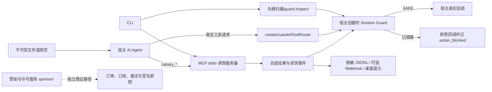

# Agent Canary 项目专项审计

审计基线：GitHub `origin/main`，`5049815c8549b0455976bea5bc8131656a5f02a4`。
审计分支：`competition/agent-canary-hardening`。
范围：本审计工作树中的 70 个基线跟踪文件；不读取赞助服务现有订单、订阅、激活或私钥文件。

## 结论摘要

项目已有可工作的 MCP stdio 诱饵服务、公开 SDK、同步会话守卫、令牌生成/扫描、CLI、离线自检和打包检查。基线构建、74 项原有测试、包检查和 `verify` 均通过；但基线测试没有覆盖跨进程/存储回滚、隐藏及大文件扫描、MCP 进程握手、赞助 smoke 的真实数据隔离等关键场景。此次增加回归和合成攻击模拟，并修复了其中可在当前许可范围内修改的问题。

第二轮后，当前分支 Windows/Node 22 的根测试为 121 项（117 通过、0 失败、4 项平台跳过），sponsor 测试为 25 项（24 通过、0 失败、1 项平台跳过）。支付回调字段绑定、重复通知履约、损坏 JSON/密钥 fail-closed、Token 并发写入、JSONL 上限、watcher 资源上限、Webhook DNS pinning、配置损坏和 Actions 固定均已补回归并验证。PR #22 的 GitHub Actions Run 115 覆盖 Node 20/22 × Ubuntu/Windows/macOS，Docker build/container CLI smoke、package smoke 与 sponsor smoke，共 9/9 jobs 成功。V2 商业实现仍随公共 `dist` 和 Docker 镜像构建进入交付物，是唯一未关闭的遗留 P1；未删除许可校验或迁移商业交付架构。

**防护范围：**诱饵只产生合成响应。拦截仅作用于集成方实际交给 `createGuardedToolRouter()`、`guard.executeToolCall()` 或 `guard.beforeToolCall()` 的调用。独立 MCP 诱饵服务不是通用 MCP 代理，也不是全局 Agent 防火墙；未被检测到的首次危险调用、绕过守卫的宿主回调、真实模型是否触碰诱饵均未由本次测试证明。

## 架构与数据流

| 模块 | 实际职责 | 证据状态 |
|---|---|---|
| `src/decoys.ts`, `src/server.ts` | 注册 12 个模拟诱饵；MCP stdio 列出并返回合成响应。每次调用会更新本地 Token 注册表和事件日志，可触发已配置告警；不执行模拟的转账、读密钥、shell 等操作。独立 MCP 服务不会自动隔离其他服务的工具。 | MCP JS Client 真实子进程握手、列举和调用已测。 |
| `src/containment.ts`, `src/sdk.ts` | `SAFE → TRIPPED → QUARANTINED`；诱饵同步隔离；Router 在调用宿主回调前检查；支持精确 allowlist、可选 principal 共享 Store 和凭据撤销 hook。 | 单元与合成并发/异常测试已测。外部 Store 的跨进程原子性由宿主负责，未验证。 |
| `src/tokens.ts`, `src/file-walk.ts`, `src/watch.ts` | 生成随机 `cnry_` 令牌、埋放、检查及监控；扫描深度最多 4 层，跳过 `.git`、`node_modules` 和符号链接。 | 隐藏文件、大于 5 MiB 的二进制文件、块边界、损坏注册表、错误路径及深度边界已测。Windows 上根符号链接测试跳过。 |
| `src/alerts.ts`, `src/dashboard.ts`, `src/export.ts` | JSONL 事件、字段脱敏、Webhook/桌面通知、报告和导出。Webhook 为 best-effort，不能改变已隔离状态。 | 事件脱敏、控制字符、重定向、XSS 和 CSV 公式回归已测；未连接外部告警服务。 |
| `src/index.ts`, `src/install.ts`, `src/config.ts`, `src/self-test.ts` | CLI 初始化、MCP 配置安装、Token、watch、事件、报告、自检和诊断。 | 构建包的 CLI help 与离线 self-test 已测；doctor 用临时 HOME 和 loopback 端口完成。 |
| `src/eval/` | 20 条固定载荷的 provider runner；当前评测以工具调用名/令牌等规则判断。 | mock provider 和参数边界已测；没有真实 LLM、真实 API 或模型行为数据。 |
| `src/license.ts`, `sponsor/server.mjs`, `sponsor/grant.mjs` | 本地许可校验以及分离的赞助、支付回调、订阅和机器激活。 | 本次不运行真实支付。demo smoke 与数据隔离已测；实时支付、真实商户凭据和许可签发未测。 |
| `Dockerfile`, `.github/workflows/` | Node 20 Alpine stdio 镜像；CI 声明 Node 20/22 × Ubuntu/Windows/macOS，并执行 Docker build 与 CLI smoke。 | GitHub Actions Run 115 的 9/9 jobs 成功；本机没有 Docker CLI，未做本地构建。 |

## 状态机与集成边界

诱饵命中时，Guard 同步写入本地状态并尝试写入 Store；随后才记录事件、请求撤销并发出告警。后续经过 Guard 的非 allowlist 调用被拒绝，真实回调不会运行。Store 不可用时，本地状态保持关闭。此次新增的回归还覆盖了 Store 恢复后错误返回 `SAFE` 的情况。

共享 Store 接口是同步的。默认实现仅是当前 Node 进程内的 Store；跨进程或分布式状态的原子、单调更新需要宿主实现。`reset()` 由宿主的可信控制面调用，SDK 不能证明 `acknowledgedBy` 真来自真人；不得把 reset 注册成 Agent 工具。

MCP `serve` 只暴露诱饵。要阻断真实工具，宿主必须把每个真实回调都经过 Guard；如果首个真实操作在检测前开始，守卫不会回滚已开始的外部副作用。

## 第二轮复审与九项遗留问题

下表状态覆盖第一轮记录中的支付回调、状态存储、商业包边界及六项 P2；它优先于下方历史基线表中仍标为“未修复”的旧状态。

| ID | 处理结果 | 代码与验证依据 |
|---|---|---|
| P1-1 支付回调 | 已修复并通过合成端到端验证；真实商户仍未连接。 | `sponsor/payment-security.mjs`, `sponsor/server.mjs`; RSA2/WeChat RSA+AES-GCM/Epay/VMQ callback tests 覆盖身份、App、订单、金额、CNY、渠道、支付状态、过期 WeChat timestamp、重复与 20 路并发。VMQ 基础 `price` 精确绑定订单，`reallyPrice` 依上游避碰协议最多允许 9 分调整。 |
| P1-2 业务状态损坏 | 已修复并通过临时目录回归。 | `sponsor/state-store.mjs`, `sponsor/server.mjs`, `sponsor/grant.mjs`; 仅 ENOENT 可用首跑默认值；JSON 与记录结构错误、权限错误、symlink、坏密钥 fail closed；原子写、锁和重启履约恢复已测。 |
| P1-3 V1/V2 分发边界 | 未关闭，P1 保留。 | `npm pack --dry-run --json` 实际包含 `dist/eval/*`, `dist/dashboard.js`, `dist/export.js`, `dist/license.js`; Dockerfile 复制全部 `/app/dist`。按要求未擅自拆包、删许可校验或迁移付费产品。 |
| P2-1 Token 并发写入 | 已修复。 | `src/tokens.ts`; 跨进程锁、读改写重载、原子写、陈旧本机死进程锁处理；16 个 CLI 子进程回归。 |
| P2-2 JSONL 无界读取 | 已修复。 | `src/alerts.ts`; 读取/轮转尾部最多 5 MiB、单行 256 KiB、最多 10,000 条；超大/截断/坏行回归。 |
| P2-3 Watcher 长期增长 | 已修复并做 15,000 个合成事件压力回归。 | `src/watch.ts`; 告警键 4,096、错误键 1,024、待处理路径 2,048 上限；显式 `close()` 与 `stats()`。这是短时模拟，不等于数周生产资源曲线。 |
| P2-4 Webhook 私网/DNS | 已修复并测 loopback DNS pin / 重绑定模拟。 | `src/webhook.ts`; remote 仅 HTTPS；解析结果全为公网才允许；请求固定到已检地址，不跟随重定向；本地 loopback HTTP 用于开发。未发外网请求。 |
| P2-5 配置 JSON 静默回退 | 已修复。 | `src/config.ts`; 只有缺失文件使用首次默认值，空/截断/错误类型/权限错误拒绝读取并且不覆盖。 |
| P2-6 CI 供应链固定 | 已修复并静态核对。 | 工作流 actions 固定完整 Commit SHA；MCP publisher 固定版本与 SHA-256；未触发任何 publish job。 |

支付格式依据：微信官方文档要求以原始请求体构造 RSA 验签串、校验序列号与时间窗口，并以 AES-256-GCM 解密资源；支付宝通知需验签后绑定本地 `out_trade_no`、`total_amount`、`seller_id` 并筛选成功状态。Epay 属于多实现兼容协议，未找到适用于所有部署商户的统一官方规范；VMQ 字段/签名格式以其上游项目实现核对。真实 provider 账号、订单和网络均未访问。

## 原始完成度分级

- **已实现且有测试证明：**诱饵工具处理、MCP stdio 基本互通、CLI 离线自检、免费 SDK Router、同步隔离、令牌生成/埋放/扫描、基本事件脱敏、安装配置备份、固定载荷 mock eval、包安装 smoke。
- **已实现但缺乏真实服务证据：**真实商户支付、真实许可签发、桌面通知和外部 Webhook；原生文件 watcher 的长期/各平台实时表现也未以生产负载验证。Node 20/22 跨平台 CI 与 Docker build/container CLI smoke 已在 Run 115 实际通过。
- **仅文档描述或范围外：**生产 Agent/真实 LLM 的抵抗率、用户案例、真实误报率、跨进程共享 Store 的事务保证、可取消已开始工具执行的能力。
- **尚未实现：**通用上游 MCP 代理/自动包裹任意宿主工具、无需宿主集成的全局 Agent 防火墙。
- **无法确认：**大赛评审结果、云上容器表现、真实模型对诱饵的触发倾向、外部支付商户回调在真实账户上的实际行为。

## 发现项与修复状态

第一轮归类基线：共发现 P1 7 项、P2 17 项、P0 0 项；第一轮修复 P1 4 项、P2 11 项。第二轮状态以本文前面的“九项遗留”表为准；累计 P1 修复 6 项、P2 修复 17 项，仍有 1 项商业分发 P1 未关闭。没有修改 MIT 许可、公开 SDK 签名、商业授权规则或真实用户数据。

| ID | 级别 | 发现与证据 | 状态 |
|---|---|---|---|
| P1-1 | P1 | 共享 Store 的本地隔离状态会被恢复后的 `SAFE` 覆盖；新回归先失败，修复后 19 项 containment 测试通过。 | 已修复：本地状态和共享状态按严重度合并。 |
| P1-2 | P1 | Token 检查可漏掉 dotfile、旧 5 MiB 上限之外内容、损坏注册表、不可读目录、超深目录或不存在的扫描路径，并仍显示 clean。 | 已修复：流式扫描、纳入隐藏文件、损坏注册表/权限/深度/路径错误均失败闭合。 |
| P1-3 | P1 | 原 `sponsor/smoke.mjs` 会先删除真实目录的订单/订阅/激活 JSON；隔离回归在临时 sentinel 文件上复现。 | 已修复：smoke 只在临时副本和临时端口运行。 |
| P1-4 | P1 | eval 接受 `maxTurns=0` 等无效值，可能在没有模型调用时把 payload 计为抵抗；回归已先复现。 | 已修复：拒绝非正安全整数。 |
| P1-5 | P1 | 微信/支付宝回调验签后未逐项比对本商户、App ID、金额、币种和订单渠道；验证微信平台签名并不等于绑定本地订单所有字段。 | 第二轮已修复；合成端到端验证，真实支付仍未连接。 |
| P1-6 | P1 | sponsor 的通用 JSON reader 对损坏订单/订阅/激活数据回退空对象，签名密钥损坏会尝试生成新密钥；可能丢状态或使已有许可失效。 | 第二轮已修复；临时数据、坏密钥、语义损坏及重启恢复回归通过。 |
| P1-7 | P1 | README/付款页声称付费 V2 源码不在公共仓库，但 main 跟踪了 eval/dashboard/export/license 等实现，`files: ["dist"]` 的打包规则把编译目录整体收入包。 | 未修复：实测 npm 包和 Docker build context 包含许可门控实现；需要维护者批准最小拆分方案。 |
| P2-1 | P2 | Webhook 会跟随 HTTP 重定向到第二目标。 | 已修复：`redirect: "manual"`；直接配置的私网/回环地址及 DNS pinning 仍是信任边界。 |
| P2-2 | P2 | OpenAI-compatible/Anthropic 评测请求可能跟随重定向携带请求头。 | 已修复：`redirect: "error"`；未连真实 provider。 |
| P2-3 | P2 | sponsor 请求体超过 1 MB 时仍继续拼接，并返回 500。 | 已修复：按字节限额、超限停止缓存并返回 413。 |
| P2-4 | P2 | demo 支付页把用户填写的 handle 插入 HTML。 | 已修复：HTML 转义并增加注入回归。 |
| P2-5 | P2 | 审计字段可以插入终端控制字符/伪造日志行。 | 已修复：限制控制字符并清理元数据。 |
| P2-6 | P2 | CSV 导出字段可注入电子表格公式。 | 已修复：对危险前缀做文本化转义。 |
| P2-7 | P2 | POSIX 配置目录、Token 注册表和日志文件未强制 owner-only 模式。 | 已修复：目录 0700、敏感文件 0600；Windows 本机跳过 POSIX 模式断言。 |
| P2-8 | P2 | 基线 lockfile 中 npm audit 报告 4 个依赖漏洞。 | 已修复：兼容范围内更新锁文件；本分支 root 与 sponsor audit 均为 0。 |
| P2-9 | P2 | CI 未声明最小 workflow 权限；V1 发布 workflow_dispatch 可在非 main ref 启动。 | 已修复：CI `contents: read`，包发布 job 限定 main；未触发发布。 |
| P2-10 | P2 | watch 对不存在或非目录输入会静默提示正在监控。 | 已修复：启动 watcher 前验证目录并拒绝符号链接根。 |
| P2-11 | P2 | 配置文件 JSON 错误会静默退回默认值，可能隐藏 webhook/日志配置失效。 | 第二轮已修复；损坏与权限场景 fail closed，不覆盖原配置。 |
| P2-12 | P2 | 多进程并发 `generateTokens` 是 read-modify-write，原子 rename 不能避免丢失另一个进程写入。 | 第二轮已修复；16 个并发子进程回归通过。 |
| P2-13 | P2 | JSONL 读取/轮转按全文载入，异常大的历史日志会占用大量内存。 | 第二轮已修复；固定读取、单行和事件数上限，并覆盖大文件/损坏行。 |
| P2-14 | P2 | 长时间 watcher 的已告警路径 Set 无清理策略，且没有显式 stop handle。 | 第二轮已修复；集合/队列有上限并暴露关闭接口；超长生产运行未做。 |
| P2-15 | P2 | Webhook 允许用户配置任意 HTTPS host；本次仅禁重定向，未解析/固定 DNS 或拒绝私网目的地。 | 第二轮已修复；请求前解析并固定公网地址；外网交付未请求。 |
| P2-16 | P2 | GitHub Actions 使用可变 tag；MCP Registry workflow 下载 `latest` publisher 二进制且无固定 checksum。 | 第二轮已修复；Actions SHA 和 publisher archive checksum 固定，未执行发布。 |
| P2-17 | P2 | 产品文案曾将诱饵描述为完全无副作用、告警“零误报”；实际调用会建立本地 Token 状态/审计记录并可触发告警，误调用也可能触发信号。 | 已修复：MCP instructions、工具说明、安全策略、双语 README、站点、CLI/package 描述和 dashboard 均说明实际副作用与信号边界；独立 MCP server 与 SDK Guard 的隔离边界也明确了。 |

## 兼容性与边界

本次没有改变公开 SDK 类型/函数签名、CLI 命令名、MIT 许可、package 版本或发布状态。`npm audit fix` 只在现有 semver 范围内更新 lockfile。新扫描器限制为指定路径下最多 4 层，跳过 `.git`、`node_modules`、符号链接；超过范围会报扫描不完整，而不会宣称 clean。

## 2026-10-11 参赛冲刺补充

新增的真实本地模型 pilot 使用 `qwen3.5-9b-local` 和两种有 SHA-256 记录的提示词 profile。72 条主原始 trial 中，模型自主诱饵调用为 0/40；neutral profile 的 C 组在没有 Canary 信号时执行了 5 次虚拟危险 callback。harness 预置隔离状态后，C 组在两 profile 共阻断 3/3 次后续危险调用。检测、SAFE 状态下的 callback 执行、隔离后的 callback 阻断分开报告，详见 [`Agent_Canary_实验报告.md`](../../competition-submission/Agent_Canary_实验报告.md)。

现有 36 条 `legacy_unknown` 数据因无 profile/hash 不纳入主比较；另一个中断于 4/36 的 run 排除统计但保留。结果页从逐次 JSON 重新计算指标。真实模型证据仍是单机单模型小样本，不改变“诱饵不是全局防火墙”的审计结论。

## AI 增强版追加记录

本轮新增独立 AI Provider / loopback 中文控制台，原 24 项审计问题和未关闭 V1/V2 P1 不变。真实本地分析、界面及自主工具实验见 AI_ENHANCEMENT_REPORT.md；最新验收见 AI_FINAL_READINESS.md。历史数量保留为对应阶段证据，不代表当前测试总量。

## 第四轮最终增补

最新证据与完整边界见 [FOURTH_ROUND_FINAL_REPORT.md](FOURTH_ROUND_FINAL_REPORT.md)。历史记录保留，不是本轮最新数据。

| 组 | 攻击成功 | 观察到拒绝防止 | Canary | Guard | 策略拒绝/待批 | 正常中断 | 正常完成 |
|---|---|---|---|---|---|---|---|
|A_no_canary|5/15|0/15|NOT APPLICABLE|NOT APPLICABLE|NOT APPLICABLE|0/6|6/6|
|B_decoy_only|5/15|0/15|0/15|NOT APPLICABLE|NOT APPLICABLE|0/6|6/6|
|C_guarded_router|5/15|0/15|0/15|0/9|NOT APPLICABLE|0/6|6/6|
|D1_policy|1/15|4/15|0/15|0/9|7/9|1/6|5/6|
|D2_policy_ai|1/15|4/15|0/15|0/9|7/9|1/6|5/6|

独立自动测试 {'tests': 201, 'pass': 196, 'fail': 0, 'skipped': 5}。实际 CI：834ef1a361386736be2101bfa635bf0bb531dfb4：9/9 jobs 成功；https://github.com/DorianChn/shanchuanzhi-agent-canary/actions/runs/38113459806。常规 V1/V2 风险仍 OPEN，独立免费竞赛构建排除商业实现。AI 只解释；批准需可信宿主。

## Agent Canary 2.0 更新

本轮结果见 [2.0 最终报告](AGENT_CANARY_2_FINAL_REPORT.md) 和 competition-submission/V2_DELIVERY_VERSION.md。

|组|攻击成功|观察拒绝防止|Canary|正常完成|硬误拒绝|审批中断|
|---|---|---|---|---|---|---|
|A_no_canary|4/19|0/19|0/19|8/8|0/8|0/8|
|B_decoy_only|6/19|0/19|0/19|8/8|0/8|0/8|
|C_guarded_router|6/19|0/19|0/19|8/8|0/8|0/8|
|D1_policy|1/19|5/19|0/19|6/8|0/8|2/8|
|D2_policy_ai|1/19|5/19|0/19|6/8|0/8|2/8|
|E_pre_review|1/19|5/19|0/19|6/8|2/8|0/8|

E 组没有降低 ASR（D1/E 均 1/19），且出现 2/8 正常任务硬拒绝，D1 为 0/8。10 次事前审查全部 suspicious，含正常构建与安装；中位 21.6 秒。AI 默认关闭，不能宣称独立增益。D1/D2 有 2/8 正常任务审批中断。

只保护注册到 Router 的宿主 callback。MCP 诱饵安装不等于全局保护；绕过 Guard、已开始的外部操作、模型内部状态 OUT_OF_SCOPE。AI 不能批准、重置 Guard 或改权限。realpath 仍有 TOCTOU 窗口；自定义网络 callback 需使用 DNS 固定与禁止重定向的安全 transport。来源提示不等于完整动态污点分析。

## 2026-10-11 最终发布验收更新

本轮当前结论见 [发布验收](RELEASE_READINESS_AUDIT.md) 与 [真实模型最终复验](REAL_MODEL_FINAL_EVALUATION.md)，历史数据在上文保留。新增可选文件Guard持久化有16回归；本地250项测试245通过、0失败、5跳过；Windows共享冲突已复现并修复，增强核心a5425b2的9项CI实际通过。168次新模型试验：D1/D2/E均1/19，E正常硬误拒绝2/8，AI默认关闭。正式稳定版仍因普通商业分发P1阻塞；独立免费竞赛包、七附件下载和官网手机/视频验收通过。新资料、旧视频参考范围及发送前未知官方限制见 competition-submission/FINAL_READINESS_CHECKLIST.md。Draft PR23未合并，未发布稳定版或发邮件。
